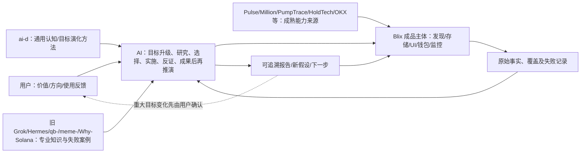

# Solana Meme｜Blix 产品主体全局入口（V0.1）

## 2026-11-09｜当前产品定位（覆盖下方历史阶段性描述）

**确定目标：完整保留原作者 Blix 产品 + 持续优化原有功能 + 在同一产品内增加专业调查与认知能力。** 这不是只读版替换工程，也不是用 Meme 研究系统覆盖原作者的交易终端。Pulse/Discover、行情图表、Coin、Wallet Tracker、Journal、原有AI、账户、纸面/真实交易、通知、Web/UI及部署组件都要作为**原版保留资产**。原版允许未来通过正常回归持续改进，不能把“保留”误解成代码永久禁止修改。

**四条不同的状态线**：

| 轨道 | 当前事实 | 不可混淆 |
| --- | --- | --- |
| 原版产品继承 | 导入完整Blix快照，原业务及UI主要保持原样 | 不等于当前目标云环境已运行通过 |
| 原产品修复与专业扩展 | `blix`有安全门禁与按需Mint基础事实层；[Draft PR #23](https://github.com/sunshihao001/grok/pull/23)叠加经济证据与钱包调查，仍待合流及实测 | 离线CI绿≠已合并/已上架 |
| 知识研究 | 旧Hermes/qb-/meme-/Why-Solana及ai-d原理与反证独立持续深化 | 研究库扩大≠AI实际已调用或产品功能已完成 |
| 运行授权与安全 | 原版交易、自动领取、模型费用功能**保留代码**；未经核验不可在当前研究环境意外启用 | 禁止未授权运行≠永久删除交易产品能力 |

**下方2026-11-06/07的“静态研究优先、暂停代码改动”是当时的工作状态，不是当前永久产品规格。** 2026-11-09 已授权继续做可逆的工程修改、文档修订、离线回归与GitHub审查；未授权私钥、签名、广播、付款、自动费用、真实交易或云端部署。优先把[交付状态](delivery.md)和[目标图](goal-map.md)按当前决策理解，保留历史研究但不再重复论证为什么选Blix。

**2026-11-06 · 已在 `grok/blix` 选择建设主体；本次交付仅为项目定位、知识导航和目标状态，尚非运行验收。**

**目标体系深化（2026-11-07）**：[《参考项目主要目标 × Blix多层目标建设 V0.1》](reference-driven-goal-model-v0.1.md) 已对照 Blix、Pulse、Million、PumpTrace、HoldTech、PumpGrok、OKX、GMGN、Cielo、Nansen、Arkham、Bubblemaps、pumpwatch、Why-Solana 及历史Hermes/qb-/meme-；把原作者目标、已经检查的业务来源、我们要建设的市场价值、不同参与者/专家视角和现阶段真实差距联系起来。不是所有参考功能已集成，也不是多建固定专家或多套产品。

**快速进入Blix知识（2026-11-07）**：从一个普通市场问题开始，优先使用 [专业知识按任务调用表](../../knowledge/README.md#2026-11-07快速知识整合与按问题进入当前优先入口)；需要更深时再查 [六类目标与七条专业知识路由](../../knowledge/DOMAIN-MODEL.v1.json)、[参考项目独有目标与可复用认识](reference-driven-goal-model-v0.1.md)和[旧源审查覆盖](../../knowledge/references/source-coverage-v0.1.json)。已有旧知识不覆盖原Blix的真实业务事实；这里只完成知识定位与原文连接，不代表AI运行时知识自动生效。

## 为什么建设？
从“找可跟单盈利钱包”逐渐扩展为“全市场发现、单 Mint 资金与库存调查、跨 Mint 群体演化、经济机制与潜在机会研究”。原赚钱/跟单兴趣没有被删，而是归入更大的研究目标。用户只需简单表达想法；AI 应主动研究、做产品/UX/工程/测试、验证、解释未知、推演更优方向。用户保留重要价值选择与风险授权。

**最新认知修订：参考项目独立完整研究不受Blix当下功能缺口限制**，仅代码集成选择遵循成熟复用和最小改动。详见 [原始项目知识纵深 V0.1](../../knowledge/references/source-knowledge-deep-study-v0.1.md) 和 [全量来源树/已读状态](../../knowledge/references/source-coverage-v0.1.json)。

**最新协作方式（2026-11-06）**：一次研究以完整业务目标及相互依赖的关键问题为单位；AI 主动统筹 Blix 产品、旧专业知识、ai-d 认知方法、跨项目证据和实际验收，不只做一个小问题后把剩余规划退回用户。最重要的整体打磨项见 [交付与优先判断](delivery.md)。相关知识按需调用，不要求每轮全量研究。当时仅授权静态只读审查；最新2026-11-09已允许在GitHub分支继续可逆的工程改动和离线测试，仍不授权未经隔离的服务、真实交易、签名、付款或付费自动化。

## 四个可快速进入的位置
| 现在要处理的问题 | 读取 |
|---|---|
| 目标在哪一层？和过去的目标有什么关系？ | [目标层级与演化](goal-map.md)、[可核查状态](state.json) |
| Blix 官网、UI、业务和代码怎样对应？ | [全主体研究](whole-product-cross-layer-audit-v0.1.md)、[官网业务能力对照](official-site-to-code-audit-v0.1.md)、[113个官网页面目录](blix-public-pages-catalog-v0.1.md) |
| Blix 已有多大能力，旧 Grok/Hermes/qb-/meme- 知识怎么进入主体？ | [主体能力与旧知识继承总图](blix-heritage-capability-baseline-v0.1.md)、[主体能力上限与旧知识内化深审](blix-knowledge-activation-ceiling-v0.2.md)、[知识与证据应用](knowledge-use.md) |
| Blix现已迁入哪些分类知识，怎样直接读取？ | [Blix本地分类知识库](../../knowledge/README.md)、[当前21项迁入与来源清单](../../knowledge/MIGRATION.json)、[参考项目源头与未迁入资产](../../knowledge/references/README.md) |
| 旧 Grok 全部152研究单元怎样分类融合进 Blix？ | [融合解释与业务边界](legacy-knowledge-fusion-v1.md)、[152单元路由索引](legacy-knowledge-routing.v1.json)；按问题调用，不默认全量注入 |
| 同一个 Mint 在不同模块的数据为什么可能冲突？ | [跨模块事实一致性深审 V0.2](mint-cross-module-evidence-audit-v0.2.md)、[外挂大脑全局审查](external-brain-completeness-audit-v0.1.md) |
| Grok Bot 与API/MCP/SSE怎样衔接？ | [云电脑三种模式](grok-bot-usage-options-v0.1.md)、[接口契约](api-mcp-sse-contract-v0.1.md)、[AI外挂大脑全局反向审查](external-brain-completeness-audit-v0.1.md)、[交付状态](delivery.md) |

以上表示**目标与能力关系**，不代表已把参考仓库接入 Blix 或创建了持续运行 Bot。项目管理的权威“当前状态”以本分支文件和后续实测日志为准，不因一个新聊天的总结自动变更。

## 从知识导航到真正的产品能力
[跨项目 × 现代 Agent 研究：知识转化为Blix业务能力蓝图 V0.1](knowledge-to-capability-integration-v0.1.md) 解释旧Grok、Hermes/qb-/meme-和Million/PumpTrace/Pulse等参考成品应分别进入事实校验、业务程序、按需AI和可验证经验，仍属静态方案，未经运行验收。

## 继承而不重造
- 原 Blix README、设计、API、UI、市场发现和交易日志保持原位；只读隔离未完成前不做实盘运行。
- 现已将21项原始或结构化来源资产登记在 `knowledge/MIGRATION.json` 并保留来源SHA；未迁入的旧 PR、历史文件和参考资产仍在原仓库，用源链接与适用范围定位，避免一次性加载。
- 每项专业扩展先问：已有完整成品直接能做吗？能调 API 吗？需要有限适配吗？为什么必须改变 Blix 核心？
- 单项任务可以直接完成，不强制“先画图—开专家会—多轮研究—再执行”。

## 版本与边界
本导航不会自动同步 GPT 记忆、ai-d Draft PR、Grok Bot 云电脑或主分支。它能帮助 AI 恢复项目，**不能单凭文件存在证明 AI 已掌握专业知识**；需要真实问题和对照测试。
