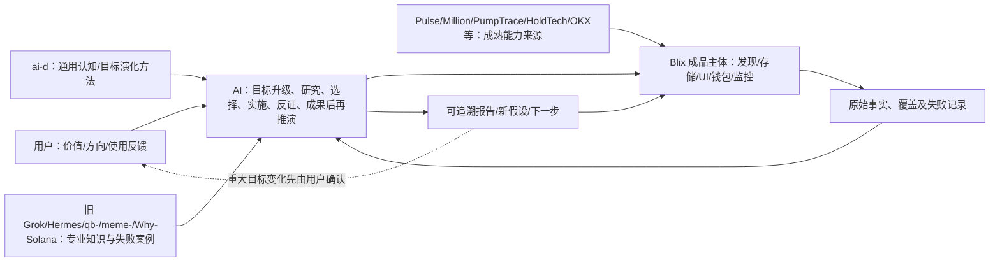

# Solana Meme｜Blix 产品主体全局入口（V0.1）

## 2026-11-24｜恢复项目的入口

当前目标是以完整 Blix 为基础，建立持续发现、调查、判断和监控 Solana MEME 交易机会，并按结果反证和改进的自主交易智能系统。业务对象是带证据、风险、时间窗和可执行条件的候选机会。先区分调查价值、机会价值与实际成交和退出条件。

- [目标图](goal-map.md)记录用户方向，[运行架构](meme-autonomous-trading-intelligence-v0.1.md)记录 Muse、Hermes、GPT 和 Blix 的候选分工，[11月15日比较研究](agent-runtime-strategy-20261115.md)保留平台研究依据。
- [状态记录](state.json)定位正式分支、集成候选和授权，[建设台账](build-register.md)记录逐提交源码与验证证据，[交付记录](delivery.md)记录进入真实业务验收的条件。
- 判断实现状态以固定提交源码、实际测试和运行证据为准。历史章节保留当时条件，项目最终目标、当前授权和实际可用能力以各自证据确认。

**2026-11-14｜专业知识全域归位与产品化入口：** 所有D01–D12专业机制、错误过滤、主述责任与原始来源由[现有knowledge主索引](../../knowledge/README.md#2026-11-14全域专业归位总入口十二领域主述参考来源知识身份与产品验收)统管；历史65参考/152单元及Synapse完整分类没有删减或假称全部已读。扩展如何从现有React/SQLite/AI sidecar走到真实成品以[单一扩展层实际交付合同](intelligence-layer.md#2026-11-14成品化实施主线知识已经归位之后)为准。最新工程状态见[建设台账](build-register.md)，旧章节仅为历史阶段记录。

## 2026-11-09｜当前产品定位（覆盖下方历史阶段性描述）

**确定目标：完整保留原作者 Blix 产品 + 持续优化原有功能 + 在同一产品内增加专业调查与认知能力。** 这不是只读版替换工程，也不是用 Meme 研究系统覆盖原作者的交易终端。Pulse/Discover、行情图表、Coin、Wallet Tracker、Journal、原有AI、账户、纸面/真实交易、通知、Web/UI及部署组件都要作为**原版保留资产**。原版允许未来通过正常回归持续改进，不能把“保留”误解成代码永久禁止修改。

**四条不同的状态线**：

| 轨道 | 当前事实 | 不可混淆 |
| --- | --- | --- |
| 原版产品继承 | 导入完整Blix快照，原业务及UI主要保持原样 | 不等于当前目标云环境已运行通过 |
| 原产品修复与专业扩展 | `blix`有安全门禁与按需Mint基础事实层；[Draft PR #23](https://github.com/sunshihao001/grok/pull/23)叠加经济证据与钱包调查，仍待合流及实测 | 离线CI绿≠已合并/已上架 |
| 知识研究 | 旧Hermes/qb-/meme-/Why-Solana及ai-d原理与反证独立持续深化 | 研究库扩大≠AI实际已调用或产品功能已完成 |
| 运行授权与安全 | 原版交易、自动领取、模型费用功能**保留代码**；未经核验不可在当前研究环境意外启用 | 禁止未授权运行≠永久删除交易产品能力 |

**下方2026-11-06/07的“静态研究优先、暂停代码改动”是当时的工作状态，不是当前永久产品规格。** 2026-11-09 已授权继续做可逆的工程修改、文档修订、离线回归与GitHub审查；未授权私钥、签名、广播、付款、自动费用、真实交易或云端部署。优先把[交付状态](delivery.md)和[目标图](goal-map.md)按当前决策理解，保留历史研究但不再重复论证为什么选Blix。

**2026-11-06 · 已在 `grok/blix` 选择建设主体；本次交付仅为项目定位、知识导航和目标状态，尚非运行验收。**

**目标体系深化（2026-11-07）**：[《参考项目主要目标 × Blix多层目标建设 V0.1》](reference-driven-goal-model-v0.1.md) 已对照 Blix、Pulse、Million、PumpTrace、HoldTech、PumpGrok、OKX、GMGN、Cielo、Nansen、Arkham、Bubblemaps、pumpwatch、Why-Solana 及历史Hermes/qb-/meme-；把原作者目标、已经检查的业务来源、我们要建设的市场价值、不同参与者/专家视角和现阶段真实差距联系起来。不是所有参考功能已集成，也不是多建固定专家或多套产品。

**快速进入Blix知识（2026-11-07）**：从一个普通市场问题开始，优先使用 [专业知识按任务调用表](../../knowledge/README.md#2026-11-07快速知识整合与按问题进入当前优先入口)；需要更深时再查 [六类目标与七条专业知识路由](../../knowledge/DOMAIN-MODEL.v1.json)、[参考项目独有目标与可复用认识](reference-driven-goal-model-v0.1.md)和[旧源审查覆盖](../../knowledge/references/source-coverage-v0.1.json)。已有旧知识不覆盖原Blix的真实业务事实；这里只完成知识定位与原文连接，不代表AI运行时知识自动生效。

**2026-11-13 全面关系收束**：[ai-d七类跨层能力与完整专业术语](https://github.com/sunshihao001/ai-d/blob/main/knowledge/foundations/cross-layer-project-anchors.md#11-2026-11-13-体系收束从关键词集合走向可解释可验证的项目关系v02)由通用项目维护，[Blix业务×知识×数据×代码×验收锚点 V0.2](cross-layer-anchor-map-20261113.md)由本项目原位维护；[知识结构交叉表](../../knowledge/INTEGRATION-CROSSWALK.md)和npm run audit:knowledge-trace -- --axes只用已有模型显示七类能力与五种网络的对应。不是新系统架构或完成全部真实运行验收。

## 2026-11-13｜当前P1/P2知识与真实功能交付入口

最新 [知识全域审查与矛盾裁决](../../knowledge/references/p1-p2-knowledge-reconciliation-20261113.md) 连接了旧Hermes/qb-/meme-/ai-d、Why-Solana、开源成品、Solana官方协议和当前代码/测试；[按问题实际使用](knowledge-use.md)解释如何调用，[建设台账](build-register.md)记录GitHub已验证状态与下一阻断。早期章节提及的“静态研究、未开发”是当时状态快照，**不能覆盖最新提交的事实**。

现有 [Draft PR #23](https://github.com/sunshihao001/grok/pull/23) 中 P1/P2 离线源码包括经济转账图、快照/跨Mint地址候选、已归档SQLite只读调查、专业知识受限选择与纸面跟单可行性审核；原版 Blix 保留。**真实RPC全历史、公共服务分类、仓位成本、自动持续监控、Coin→正式模型执行和策略收益尚未验收**。本入口只是恢复知识和工作状态，不代表已经部署或合并。

## 为什么建设？
从“找可跟单盈利钱包”逐渐扩展为“全市场发现、单 Mint 资金与库存调查、跨 Mint 群体演化、经济机制与潜在机会研究”。原赚钱/跟单兴趣没有被删，而是归入更大的研究目标。用户只需简单表达想法；AI 应主动研究、做产品/UX/工程/测试、验证、解释未知、推演更优方向。用户保留重要价值选择与风险授权。

**最新认知修订：参考项目独立完整研究不受Blix当下功能缺口限制**，仅代码集成选择遵循成熟复用和最小改动。详见 [原始项目知识纵深 V0.1](../../knowledge/references/source-knowledge-deep-study-v0.1.md) 和 [全量来源树/已读状态](../../knowledge/references/source-coverage-v0.1.json)。

**最新协作方式（2026-11-06）**：一次研究以完整业务目标及相互依赖的关键问题为单位；AI 主动统筹 Blix 产品、旧专业知识、ai-d 认知方法、跨项目证据和实际验收，不只做一个小问题后把剩余规划退回用户。最重要的整体打磨项见 [交付与优先判断](delivery.md)。相关知识按需调用，不要求每轮全量研究。当时仅授权静态只读审查；最新2026-11-09已允许在GitHub分支继续可逆的工程改动和离线测试，仍不授权未经隔离的服务、真实交易、签名、付款或付费自动化。

## 四个可快速进入的位置
| 现在要处理的问题 | 读取 |
|---|---|
| 目标在哪一层？和过去的目标有什么关系？ | [目标层级与演化](goal-map.md)、[可核查状态](state.json) |
| Blix 官网、UI、业务和代码怎样对应？ | [全主体研究](whole-product-cross-layer-audit-v0.1.md)、[官网业务能力对照](official-site-to-code-audit-v0.1.md)、[113个官网页面目录](blix-public-pages-catalog-v0.1.md) |
| Blix 已有多大能力，旧 Grok/Hermes/qb-/meme- 知识怎么进入主体？ | [主体能力与旧知识继承总图](blix-heritage-capability-baseline-v0.1.md)、[主体能力上限与旧知识内化深审](blix-knowledge-activation-ceiling-v0.2.md)、[知识与证据应用](knowledge-use.md) |
| Blix现已迁入哪些分类知识，怎样直接读取？ | [Blix本地分类知识库](../../knowledge/README.md)、[当前21项迁入与来源清单](../../knowledge/MIGRATION.json)、[参考项目源头与未迁入资产](../../knowledge/references/README.md) |
| 旧 Grok 全部152研究单元怎样分类融合进 Blix？ | [融合解释与业务边界](legacy-knowledge-fusion-v1.md)、[152单元路由索引](legacy-knowledge-routing.v1.json)；按问题调用，不默认全量注入 |
| 同一个 Mint 在不同模块的数据为什么可能冲突？ | [跨模块事实一致性深审 V0.2](mint-cross-module-evidence-audit-v0.2.md)、[外挂大脑全局审查](external-brain-completeness-audit-v0.1.md) |
| Grok Bot 与API/MCP/SSE怎样衔接？ | [云电脑三种模式](grok-bot-usage-options-v0.1.md)、[接口契约](api-mcp-sse-contract-v0.1.md)、[AI外挂大脑全局反向审查](external-brain-completeness-audit-v0.1.md)、[交付状态](delivery.md) |

以上表示**目标与能力关系**，不代表已把参考仓库接入 Blix 或创建了持续运行 Bot。项目管理的权威“当前状态”以本分支文件和后续实测日志为准，不因一个新聊天的总结自动变更。

## 从知识导航到真正的产品能力
[跨项目 × 现代 Agent 研究：知识转化为Blix业务能力蓝图 V0.1](knowledge-to-capability-integration-v0.1.md) 解释旧Grok、Hermes/qb-/meme-和Million/PumpTrace/Pulse等参考成品应分别进入事实校验、业务程序、按需AI和可验证经验，仍属静态方案，未经运行验收。

## 继承而不重造
- 原 Blix README、设计、API、UI、市场发现和交易日志保持原位；只读隔离未完成前不做实盘运行。
- 现已将21项原始或结构化来源资产登记在 `knowledge/MIGRATION.json` 并保留来源SHA；未迁入的旧 PR、历史文件和参考资产仍在原仓库，用源链接与适用范围定位，避免一次性加载。
- 每项专业扩展先问：已有完整成品直接能做吗？能调 API 吗？需要有限适配吗？为什么必须改变 Blix 核心？
- 单项任务可以直接完成，不强制“先画图—开专家会—多轮研究—再执行”。

## 版本与边界
本导航不会自动同步 GPT 记忆、ai-d Draft PR、Grok Bot 云电脑或主分支。它能帮助 AI 恢复项目，**不能单凭文件存在证明 AI 已掌握专业知识**；需要真实问题和对照测试。

## 2026-11-15｜专业扩展、经济证据与研究方法

> 本节保留经济证据、业务能力与研究方法；项目目标和运行角色见页首入口。

### 1. 产品北极星
Blix 是完整产品主体，不是被AI研究系统替代的只读研究壳。原有市场发现、Pulse/Discover、Coin、Wallet、图表、Brain、Paper、Journal、账户、交易及UI能力原则上保留；本项目的专业扩展是在其上提高 Solana Meme真实机会发现、资金/钱包行为调查、经济证据、跨Mint追踪、可参与性判断和持续复盘的可靠性。

“值得调查的Mint”和“具有实际交易机会的Mint”是两个结论，后者优先；研究价值不能自动升级为交易价值。

### 2. AI的正确位置
AI不是第二套选币器、第二套采集器或固定专家委员会。AI应利用已有Blix能力、只读数据工具和按需专业知识，自主决定：当前问题是什么、哪些证据缺失、需要调用哪个已有工具/知识、竞争解释是什么、什么时候停止、下一件最有价值的取证是什么。只有当模型无法可靠获得数据、需要确定性经济计算、需要认证/配额/审计/状态、或真实反馈暴露程序瓶颈时才增加代码。

知识库不是产品运行流水线。G/L/D/K及其他知识坐标只用于追溯、选择、适用边界和生命周期管理，不要求每个Mint经过固定多层知识筛选，也不因知识数量增加而宣称专业度提高。

### 3. 当前事实等级必须分开
后续AI不得混淆：
- CODE_OBSERVED：源码确实存在；
- OFFLINE_TESTED：合成/离线测试通过；
- ARCHIVED_REAL_REPLAY：固定真实历史输入可重放；
- CONNECTED_READONLY_RUNTIME：授权真实只读运行；
- PROSPECTIVE_SHADOW：前瞻影子观察；
- SECURE_OPERATIONAL：达到安全运行条件；
- MODEL_INTERPRETATION：模型推断/解释；
- UNKNOWN：证据不足。

源码存在、CI通过、模型说对、主网真实有效、可实际成交和产生净利润，都是不同命题，禁止跨级推断。

### 4. 业务事实主线
所有重要经济判断尽量沿同一证据链回溯：
Mint → 首可见事件/市场信号 → 原始signature/slot → Token Account/Owner → 买入/Swap/Transfer/CPI → 接收钱包 → 后续出售候选 → SOL/WSOL及其他资金流 → 库存/成本/费用/PnL → 跨Mint联系 → 可参与性/失败风险。

硬性反例：Token Transfer ≠ Sale；Token Account ≠ Owner；接收后卖出 ≠ 证明卖的是刚收到的库存；共同资金来源/同Bundle/同Slot ≠ 同控制人；跨Mint时间相邻 ≠ 资金接力；gross PnL ≠ net PnL；迟到回补 ≠ 当时市场动量；涨幅 ≠ 用户当时可成交结果。

无法证明时保留 UNKNOWN，不要用AI解释填空。

### 5. 业务能力地图，不是强制流水线
当前能力收束为：
- O1 市场发现：Mint-first、首可见时间、候选分母、遗漏/拒绝原因；
- O2 钱包与主体：角色、Token Account/Owner、协同行为、关联候选；
- O3 经济事实：买/卖/转仓、库存、成本、费用、PnL及历史覆盖；
- O4 跨Mint：资金接力、群体迁移、重复行为和证据链；
- O5 机会评价：时效、报价、流动性、滑点、容量、退出和实际可参与性；
- O6 持续研究：Case、迟到数据、回补、恢复、AI重审和结果反馈。

O1–O6可按问题跳转；不要求固定六步执行。

### 6. 知识污染规则
已否证的旧主张必须从“当前有效知识”入口降级/阻断，但历史原文一般不应粗暴删除，因为其中可能仍有有效证据。当前做法是：保留历史 → 明确裁决 → 标注适用/失效 → 用负例测试防止旧结论重新进入当前上下文。最近已用 wallet_sig_windows 多行/无序旧假设做过一个stale-claim负例；该负例的CI尚未验证，因此不能称知识污染问题已解决。

### 7. 当前工程优先级
不新建平行架构、冗余采集状态机、大量知识治理文件或专家制度。优先复用原Blix与PR #23已有模块，在原位修复可重复反例。当前最高价值验证方向是 R1真实Mint源级纵切：固定一个真实Mint和时间窗，沿上述经济证据链检查真实签名、Token Account/Owner、转仓、接收方卖出候选、资金流和跨Mint联系；重点找能推翻当前解释的反例。

### 8. PR与安全边界
PR #23是当前主要集成候选；PR #24的选定AI工作流能力已被当前集成路线吸收，不应再建立第二套AI实现。当前工作允许在现有未合并开发分支做可逆代码/文档/测试修改并核查CI；禁止自行合并、部署、启动原Blix服务器、交易签名、链上广播、付款、非授权供应商费用或扩大权限。原版交易功能保留，不因研究环境限制而删除。

### 9. 每轮工作的判断标准
每轮只问一个最高价值问题：它是否会改变真实市场判断、经济证据可信度、产品能力、工程可靠性或AI实际选择？若只是增加知识层级、关键词、报告数量或抽象框架而没有可复现价值，则停止。

交付必须明确：做成什么、源码/测试/CI证据、真实运行等级、模型解释、错误与反例、UNKNOWN、下一阻断。没有实质增量就明确写“未取得”，不凑成果。

扩展工作台实施背景见 [11月13日方案](blix-ai-workbench-master-plan-v1-20261113.md)。
