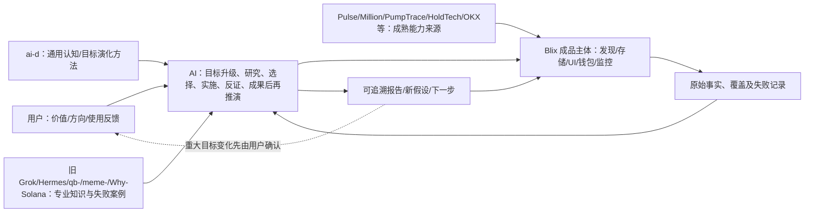

# Solana Meme｜Blix 产品主体全局入口（V0.1）

**2026-11-06 · 已在 `grok/blix` 选择建设主体；本次交付仅为项目定位、知识导航和目标状态，尚非运行验收。**

## 为什么建设？
从“找可跟单盈利钱包”逐渐扩展为“全市场发现、单 Mint 资金与库存调查、跨 Mint 群体演化、经济机制与潜在机会研究”。原赚钱/跟单兴趣没有被删，而是归入更大的研究目标。用户只需简单表达想法；AI 应主动研究、做产品/UX/工程/测试、验证、解释未知、推演更优方向。用户保留重要价值选择与风险授权。

## 四个可快速进入的位置
| 现在要处理的问题 | 读取 |
|---|---|
| 目标在哪一层？和过去的目标有什么关系？ | [目标层级与演化](goal-map.md)、[可核查状态](state.json) |
| Blix 官网、UI、业务和代码怎样对应？ | [全主体研究](whole-product-cross-layer-audit-v0.1.md)、[官网业务能力对照](official-site-to-code-audit-v0.1.md)、[113个官网页面目录](blix-public-pages-catalog-v0.1.md) |
| D01–D12、Hermes 和 ai-d 怎么帮助判断？ | [知识与证据应用](knowledge-use.md) |
| Grok Bot 与API/MCP/SSE怎样衔接？ | [云电脑三种模式](grok-bot-usage-options-v0.1.md)、[接口契约](api-mcp-sse-contract-v0.1.md)、[AI外挂大脑全局反向审查](external-brain-completeness-audit-v0.1.md)、[交付状态](delivery.md) |

以上表示**目标与能力关系**，不代表已把参考仓库接入 Blix 或创建了持续运行 Bot。项目管理的权威“当前状态”以本分支文件和后续实测日志为准，不因一个新聊天的总结自动变更。

## 继承而不重造
- 原 Blix README、设计、API、UI、市场发现和交易日志保持原位；只读隔离未完成前不做实盘运行。
- 旧 Grok 的研究 PR 与 ai-d 独立研究保留在原仓库，不全文复制；用原始链接和适用范围定位。
- 每项专业扩展先问：已有完整成品直接能做吗？能调 API 吗？需要有限适配吗？为什么必须改变 Blix 核心？
- 单项任务可以直接完成，不强制“先画图—开专家会—多轮研究—再执行”。

## 版本与边界
本导航不会自动同步 GPT 记忆、ai-d Draft PR、Grok Bot 云电脑或主分支。它能帮助 AI 恢复项目，**不能单凭文件存在证明 AI 已掌握专业知识**；需要真实问题和对照测试。
