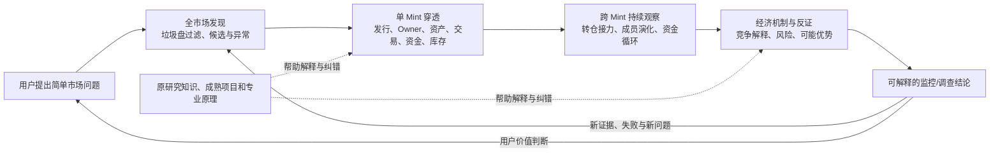

# Solana Meme × Blix｜项目目标锚点与认知深化图（V0.2）

## 2026-11-14｜Synapse 源码纵深研究的新增纠偏

依据 [Synapse 全分类机制纵深与 Blix 实际缺口](../../knowledge/references/synapse-cross-signal-mechanisms-20261114.md)，**纠正“Blix 没有钱包→Mint 入口”的推测**：engine.js 已连接 wallets.walletSignals，钱包买入可 adopt Mint、vet 并 raise 告警，且部分关联地址按 independent() 启发式折叠。真实增量不是复制钱包追踪，而是验证已有钱包信号如何进入 AI 深读和跨 Mint 调查，以及不同模块是否保留相同经济对象：research.js 对 followedWalletsBought 统计原始 distinct wallet，不能直接等同 walletSignals 的关系组数；wtrack.js 的 fromTx 在发现 Swap 后直接返回，有同笔 Swap+Transfer 漏记转仓的源码条件（待真实 fixture 验证）。外部跟单回测/样本外反证再次确认：钱包群体结构和高质量信号本身不等于可复制净收益。此前“钱包事件成为候选的另一条入口”应解释为**深化已有入口及跨模块升级**，不是从零新增。优先对照既有 Blix 与证据增强后的候选质量、钱包独立性、真实资金/库存与执行延迟；禁止只增加标签数或重建筛选器。

## 2026-11-14｜Synapse 全分类提取补充（覆盖而非选摘）

前一节为**面向 Blix 当前业务决策的选用摘要**，并非对整个 Synapse 文档的知识覆盖范围判断。根据用户进一步指正，所有源类别已经按原名、原义和原市场范围完整登记在 [Synapse 全分类与深度延伸目录](../../knowledge/references/synapse-methodology-full-taxonomy-20261114.md)：14/14 链上信号、3/3 DEX 事件、3/3 买入形态、4/4 HyperLiquid 信号、5/5 行为标签，以及全部方法原则、噪音、产品/合规条目；另有 T01–T14 **我们提出的**研究方向。不能将上一节的 A/B/C 适配等级当作保留/删除知识的门槛：**研究范围完整开放，代码实现按已验证缺口审慎选择**。用户上传资料为转述笔记，未逐条核实原站，更不代表这些信号已经在 Blix 接入、有效或能带来交易收益。

**参考项目→多层目标的完整建设基准（2026-11-07）**：[《参考成品逆向构建的多层目标体系 V0.1》](reference-driven-goal-model-v0.1.md)。它沿用本页G0–G4，增补原成品作者目标/可见业务、不同市场参与者的隐含目的、按问题调用的专家视角、Blix统一主体的并行使用目的、现有源码承接点和具体验收差距。**这是本页的深化，不是新软件架构或替代用户已确认目标。**

> 2026-11-06，**当前方向的可修订基准**。用户已表达“按不同层面大致锚定目标，防止偏离，深化后可以改”的意图；下文的细分目标和专业解释包含 AI 的候选提炼，**不是每条都已由用户最终确认**。本文只帮助研究、判断和纠偏，不是新的固定阶段、专家制度、Bot 设计或默认长提示词。

## 2026-11-09｜产品继承范围的正式修正（优先于历史G3/G4工作描述）

**上位产品目标：原版完整 Blix 终端功能 = 必须保留的基座；Solana Meme 专业调查、资金监控与经济机制 = 持续增加的能力。** 不因研究从跟单扩展到市场智能，便把原版的交易、纸面交易、账户、K线、行情筛选、Pulse、Wallet Tracker、原AI及部署等视为要淘汰的功能。保留原样的源码、对原版做必要维护、开发新增功能三者都可以是正确成果。

**G3修正解释**：当前工程选择是全产品延续与二次开发，并非替换产品定位；Blix原版功能没有被“只读调查”覆盖。需要明确区分“原版功能保留”与“在当前研究/测试环境中是否授权真实运行”。安全门禁可阻止未经授权的副作用，但不应移除原版业务源码、用户入口或今后的正常部署能力。

**G4当前推进**：从已完成的全项目源码理解转向原版保留回归、候选PR整合、离线业务验收、安全隔离与真实样本调查。下方2026-11-06“只读全主体理解、不修改代码”属于历史阶段，2026-11-09允许可逆的分支开发与离线CI；仍不授权真实交易、签名、付款、自动费用或云端部署。理论研究与工程交付并行、各自独立评价，不把研究文档数当完成功能。

**改动决定权**：原版功能允许为修复/升级被主动修改，但涉及删除、无法恢复的破坏性改造、改变交易权限或部署策略，需明确批准和回归。若新专业模块改变旧钱包/账户服务，先检查原行为再接受新增功能；外部原作者新版本按差异评估，不盲目同步覆盖本分支。

## 0. 原意：目标相近但并不等同，不能互相吞并

- **最初的问题**：找到值得观察/跟随的钱包，弄清盈利、风险与可复制性。没有废弃，只是不再代表整个项目。
- **逐渐扩大的市场目的**：持续观察 Solana Meme 市场，从发行、交易、钱包、资金、持仓、群体到价格形成与经济机制，发现异常、风险、可能的机会和此前未认识的规律。
- **产品目的**：尽量以成熟 Blix 整套产品为当前基石，把真实市场发现、单 Mint 调查、跨 Mint 观察等在一个产品中贯通；先研究清楚已有业务与代码，再考虑修改、整用或补全。
- **AI 协作目的**：人只用口语表达意图；AI 自主升级问题、选择相关专业知识、深入外部证据和原代码、提出竞争方案、在授权内实施并验收；不能用漫长的知识整理代替产品成果。
- **2026-11-06 的历史阶段性限制**：当时要求“先不运行，先理解主体”，暂停改代码；**最新2026-11-09已授权继续可逆开发与离线验收，但尚未授权交易、签名、付款、自动模型费用或部署**。保留当时研究成果，不将过期限制提升为永久产品目标。

以上是**并行且相互支持的目的**：市场情报不只是跟单；专业认知不只是写研究报告；工程设计不只是完成一次 API 测试。

## 1. 纵向目标锚点：稳定的是目的，变化的是认识与手段

| 层次 | 当前锚点（它回答什么问题） | 当前状态 / 决策权 | 何时允许改变 |
|---|---|---|---|
| **G0｜价值和人** | 以更少专业指挥负担，理解市场运作、风险和潜在经济价值；用户保有重要取舍与资金权限。 | 核心意图来自用户；价值取舍由用户决定 | 用户的价值目标真正变化时 |
| **G1｜长期产品与研究定位** | 一套可持续演化的 **Solana Meme 市场智能系统**，兼顾产品业务、经济机制认知与 AI 协作能力，而非单纯跟单信号器。 | 方向已明确；具体边界可深化 | 新发现能显著改变产品价值定位时，提出备选由用户决定 |
| **G2｜并行业务与能力目标** | ①市场发现和过滤 → ②单 Mint 调查 → ③跨 Mint 资金/群体监控 → ④经济机制、风险和潜在机会研究；可靠数据、可解释 UI、历史追溯和运行可靠性贯穿全部。 | 业务主线来自用户；细节和优先顺序允许 AI 研判 | 源码、同行经验或真实任务证明有更好的业务划分时 |
| **G3｜产品与工程路线** | **完整保留原版Blix成品，并在同一产品上进行功能二次开发**；允许原版持续维护、按真实业务缺口新增专业模块；Grok Bot仍是待验候选环境。 | 用户2026-11-09明确确认“原版也要，现有工作是扩展” | 具体扩展实现可变，但未经确认不删除原版产品能力 |
| **G4｜当前任务与交付** | **保护原版能力、收束已有专业扩展、完成可验收的局部代码及离线业务回归**；再决定安全隔离运行和UI对接。 | 当前已授权GitHub可逆建设；原Blix高风险运行与真实交易未授权 | 真实测试、运行条件或新业务证据会改变当前实施排序 |

G0–G4 是**目标关系语言**，不是五个软件层、五个 Bot、五份每轮必填表格。**G4 的完成不自动证明 G2 已实现。**

### 最关键的三条横向锚点

同一个 G1 下必须同时保留三个观察方向，不能被任何一个吞并：

1. **业务与使用价值（为什么做）**：自动从市场噪声中找到可调查对象，持续看懂 Mint、钱包、群体，产生可追溯的调查结果，最终服务人的风险/机会判断。
2. **专业认知与发现（为什么这样解释）**：从链上事实推演经济行为，从行为提出资本组织/库存/价格形成的多种机制解释，主动反证，寻找此前不知道的问题和规律。
3. **工程与证据可信度（为什么可以相信）**：完整且时间正确的数据、链上资产与身份区分、失效/缺口说明、只读安全、运维与成本、成熟功能复用。没有可信事实，认知结论不能升级为确定结论。

**AI 人机协作**是一条贯穿以上三者的工作能力，而不是强制把 AI 放在 Blix 内部实现全部功能；通用方法在 [ai-d](https://github.com/sunshihao001/ai-d)，Solana 业务知识保留在本项目及原 Hermes/qb-/meme-/Why-Solana 等资产。

## 2. 业务全局：同一条贯通的价值链，不是四套互不相干的软件

- **市场发现的成功尺度**：不仅有新币列表，还要知道来源、筛选规则、覆盖与漏检、活动持续性，以及为何升级调查。
- **单 Mint 的成功尺度**：能追溯关键事实来源、时间、交易签名/动作、Token Account 与 Owner、Dev 候选、资金/库存变化、池与公共设施，清楚报告未知。
- **跨 Mint 的成功尺度**：不是列相似钱包，而是有时间连续性、成员变化、资金/资产路径、基线及多种解释；不把同时间买入自动归因为同控。
- **机制研究的成功尺度**：能解释并用新证据反驳/修正候选机制，区分结构规律、因果假设及真实决策价值；不从历史收益跳到可复制盈利。
- **统一交付的成功尺度**：优先在 Blix 现有 UI/业务路线上展现上述结果，避免重新做市场终端、重复统计、重复历史存储。

业务链允许根据进一步市场认知合并或新增环节；**“市场发现 → 单 Mint → 跨 Mint → 机制”表示典型问题演化，不是所有任务必须逐级经过的固定流水线。**

## 3. 更深一层：专业认知目标不是更多术语，而是解释能力升级

| 认识深度 | 要真正弄清的专业问题 | 必须保留的边界 |
|---|---|---|
| **观察事实** | 哪个 Mint、Slot、签名、指令/事件、账户和资产在何时发生什么？数据来自何处、覆盖多少？ | 供应商统计、链上事件、缓存结果不混写 |
| **复原经济动作** | 谁支付了什么、收到什么、持有多少；多池、CPI、SOL/WSOL、费用、Token Account/Owner 如何还原？ | 单个净余额或单一 Swap 标签不能概括多动作交易 |
| **发现行为结构** | 钱包群体是否存在资金接力、转仓、拆分、库存迁移、跨币重复与时间先后？ | 共享服务、普通跟风、样本选择、缺失历史都是竞争解释 |
| **形成经济机制** | 哪些资本约束、执行位置、流动性供需和激励结构能产生这些模式？ | 关联图不自动证明庄家、内幕或共同控制 |
| **反证与决策价值** | 机制能否预测后续可观察事实？与基线及执行成本相比是否带来新增信息？ | 必须允许 UNKNOWN、失败结论和无交易优势 |

这里的“认知深化”是一条**可选的研究深度轴**：一条高质量结论可能只停留在链上事实，也可能有足够证据形成机制解释。**不为了做深而强制推断更高层结论。**

## 4. 目前 Blix 主体理解的工程锚点

研究不是逐个文件夹罗列，而是对一条用户业务路径建立可回查的对应：

`用户操作 / 页面与路由 → API / 实时事件 → 服务端业务逻辑 → 原始提供方与链上数据 → 存储与缓存 → 计算与归因 → 展示和故障行为 → 测试证据`

全主体至少覆盖以下**问题视角**，按实际依赖交叉研究，非必须逐个线性完成：

- **UI/UX 与业务**：`web/src/` React、`public/` 经典页面，Discover/Pulse/Coin/Tracker/Narratives/Health/Account；页面存在、路由可达、真实被使用需要分别核查。
- **市场与 AI 引擎**：`engine.js`、`sources.js`、`quality.js`、`triage.js`、`research.js`、`brain.js`，对比作者原始业务目标与我们的市场智能目标。
- **Mint 与钱包事实**：`coin.js`、`holders.js`、`holderslive.js`、`wallets.js`、`wtrack.js`、`solana.js`；重视多源优先级、来源时间、钱包角色、历史/群体覆盖。
- **历史和状态可靠性**：`db.js`、`journal.js`、`journalfeed.js`、`candlestore.js`、`apicache.js`；区分原始事件、汇总 K 线、缓存快照和不可恢复的信息。
- **产品工程和风险边界**：`server/server.js`、`webapp.js`、`worker/`、`accounts.js`、Vault、部署/测试/事故；区分只读请求与后台副作用、真实交易/签名/外部收费路径。
- **外部参考的整合落点**：先查 Blix 当前是否已有相同业务，再按缺失的事实粒度和真正的功能边界比较 Million、Pulse、HoldTech、PumpTrace、OKX、Why-Solana 等；不得预设全量引入。

### 本轮已据源码发现的「需要保留的疑问」

- `/api/holders/:mint` 与 `/api/coin/:mint` 的持仓来源及完整度并不相同，不能随手选一个当唯一标准。
- `solana.js/parseSwaps` 会跳过含多个非报价代币净变化的交易；钱包监控与完整经济事实重建不是同一需求。
- `wallet_trades` 的 `(sig,wallet,mint)` 唯一键、`journal.js` 的24小时交易保留与 `wtrack.js` 的7天活动保留，限制完整资金/群体历史。
- 读取 Coin 页面可能触发后端数据补充；`GET` 不必然意味着没有提供方配额消耗。
- 生产服务包括 React/经典 UI、Radar、Web 页面服务、Cloudflare Worker 和账户/Vault 路径；原作者的历史部署证明不能替代本项目实跑验收。

上面是**SOURCE_READ + 分析判断**，不等于已经复现缺陷、跑完所有测试或实际调用过主网。

## 5. 防偏离的轻量判断：只问会改变决定的事情

研究或提议增建功能时，在需要的情况下检查：

1. **它服务哪一个 G1/G2 目标？** 如果只改善搜索词、模块数量、目录整齐或局部测试，却对业务/认知/证据没有影响，降低优先级。
2. **当前 Blix 是否已经有可用的整套流程？** 看 UI、业务代码、API、数据真实来源，而不是发现一个开源库就复制。
3. **新证据改变什么？** 是推翻现有事实口径、解释机制、产品价值，还是只带来一个有趣的新名词？
4. **额外研究还能改变决策吗？** 能，继续穿透；不能，记录边界并停止，不为凑一轮研究强行制造知识。

例：研究 `parseSwaps` 很深入，但如果最后只有“解析器需要重写”，没有说明它影响 Mint 持仓、钱包转仓、跨币监控的哪条业务链，就是**局部工程取代整体目标**。反过来，如果源码证明多动作交易被丢掉，这一事实会改变未来复用项目与数据保留的路线，就有继续研究的价值。

## 6. 什么可以锁、什么必须允许变化

| 类别 | 处理 |
|---|---|
| **相对稳定** | 用户的整体目的；市场发现、Mint、群体、机制等并行诉求；事实与推论分离；只读边界（直到另获授权）。 |
| **随研究深化** | 业务分类、对象定义、经济机制假说、哪些指标真正有预测意义、成熟成品能解决哪些问题。 |
| **可推翻的路线** | 选择 Blix 为当前主体的工程适合性；UI/接口位置、数据源、是否需要独立专业层、Grok Bot 承接方式。 |
| **可以及时切换的局部任务** | 目前的源码追踪顺序、待查测试、参考项目比较、单个新发现；不默认升级为新的长期目的。 |

当发现更深入的新目标时，AI 应说明是 `refines`（深化）、`extends`（扩展）、`alternative_to`（替代候选）、`conflicts_with`（冲突）还是 `supersedes`（确认替代）。**AI 提议可以很主动，但不能未经用户决定就替换 G0/G1。**

## 7. 2026-11-06 历史研究交付条件与暂停项（已由最新开发授权部分替代）

**当时允许（2026-11-06）**：GitHub 只读查源码与历史、外部原始论文/官方文档研究、跨层业务追踪、竞争解释、将核实结论写入本分支项目文档、回读核对。无需每研究一个子问题就重新征求确认。

**当前暂停**：运行 Blix、装依赖、接入模型/RPC/外部配额、调用真实 Mint 接口、云电脑部署、改市场/账户代码、签名、交易、付款。后续执行需用户新指令。

本阶段有意义的完成物不是文件数，而是：主要业务在 UI→API→核心代码→数据与存储→权限/运维→证据的映射；已有、重复、缺失及 UNKNOWN 清楚；关键错误假设与整用/有限修改/组合路线可比较。**只有研究结论足以指导具体集成判断时，才称“主体已经理解到可决策程度”；不声称每个文件逐行证明。**

## 8（新增认知）｜2026-11-07 ai-d 最新研究怎样修正问题表征，而非替换目标

**固定的目标关系不变**：现有G0–G4只是Meme项目内部目标语言。用户仍希望Blix单主体承担市场发现、单Mint调查、跨Mint观察、经济机制理解与可验证机会研究，AI负责口语意图升级、跨源调查、授权内交付。ai-d [认知增强研究](https://github.com/sunshihao001/ai-d/blob/84b9d3fe4e22d6c1621623cf26deb4b3ab5092e7/research/2026-11-07-human-ai-cognitive-augmentation-foundations.md) 与 [人机委托研究](https://github.com/sunshihao001/ai-d/blob/84b9d3fe4e22d6c1621623cf26deb4b3ab5092e7/research/2026-11-07-human-ai-delegation-performance-learning.md) 属于横跨多个领域的**上游研究方法**，不能把“人的发展/学习”新愿景自动替代本项目领域目标。其[更宽广的人类能力愿景](https://github.com/sunshihao001/ai-d/blob/aba723074d2c1a83fb129bd14473fa571f29ad34/README.md)目前还在Draft分支，属于ai-d的独立上位研究，不是Blix已有业务或已确认新产品。

**新的问题表征重心**：[ai-d 2026-11-07未知发现研究](https://github.com/sunshihao001/ai-d/blob/84b9d3fe4e22d6c1621623cf26deb4b3ab5092e7/research/2026-11-07-problem-driven-unknown-discovery.md) 要求从“用户已给出的术语→查相近知识”进入“识别旧解释隐藏变量、观察机制、竞争生成机制、跨领域中间关系、反例”。并非所有重要未知都是新的操盘手法；**未知至少有四种不同对象**：已知资料缺口、尚未意识到的问题缺口、此前未建立的跨行业机制联系、尚无可重复证据证实的真正开放世界未知。AI只能主张自己找到了可检查的新问题/关系，不得自称发现了无人知晓的市场定律。

**对业务价值链的具体修正**：同一“早期钱包活动/拉升前资金异动”须区分(1)实际市场经济过程，(2)数据源监听/筛选/保存/补录/优先级的观察过程，(3)AI从观察生成解释的推理过程。Hermes提供反向机制问题，qb定位证据对象和契约，meme提供失败样本/竞争解释，Pulse/Blix等源码揭露观察管道边界；**是否接入代码**独立于**是否值得继续学习该知识**。上述三者可作为研究维度，但不是必须在每个普通问题上执行的三个步骤或三个Bot。

**人机分工的新限制**：ai-d 依据2024年106实验的系统综述与2026年487人随机试验，区分“AI在场任务表现”“没有AI时人的独立技能”“人机协同能否优于单方”。对当前Meme项目，用户要的是低专业指挥负担和可核查成果，**不应被迫学习编程或每步审批**；AI在已有授权和只读边界内直接研究/写入文档/回读核验，重要方向、真实资金、签名、付款等由人保有决定权。不能据论文推断Blix已证明有协同优势，也不把用户学会市场研究当成产品交付的必要条件。

**研究成功的新判据**：不是读过项目/新增领域/得出更复杂叙述，而是新来源或学科能够**真正改变某个调查问题的表征、暴露此前遗漏且可核查的变量、区别两种机制、纠正现有事实或改善已有Blix成果**。其余价值不明材料保留原文与未解问题，不因目前无产品位置丢弃；避免无限扩展、无证据类比和过度上下文注入。

**当前验收状态**：仅上游新研究原文核查、既有Solana源码/确定性反例对照与Blix知识关系修订；并无新的独立模型A/B、真实钱包回放、市场因果机制证实或Grok Bot运行时调用。本论证不改变现有只读限制。

## 8. 知识与历史入口

- [Blix 主体导航](README.md) · [能力/参考地图](capability-map.md) · [当前交付状态](delivery.md) · [知识与证据用法](knowledge-use.md)
- [ai-d：目标导航研究](https://github.com/sunshihao001/ai-d/blob/proposal/goal-planning-knowledge-delivery-20261106/planning/goal-navigation-v0.1.md)：多目标、分层与主动纠偏；方法草案，不是自动目标算法。
- 原 Grok [PR #14](https://github.com/sunshihao001/grok/pull/14) / [#16](https://github.com/sunshihao001/grok/pull/16) / [#17](https://github.com/sunshihao001/grok/pull/17)，Hermes、qb-、meme- 和 Why-Solana 的原始研究仍原位保存，**知识资产继续有用，历史固定流程不再默认控制新研究**。

**一句话锚点：以 Blix 为当前可修订的产品主体，从市场事实和业务需求出发，理解整个系统，逐步复原经济行为、解释并反证机制，最终形成持续可信的只读市场智能能力；AI 主动承担研究和整合判断，用户掌握重要方向与风险决定。**

## 2026-11-07｜多主体目标与多专家视角：目标不是只有一个正确版本

> 本节是对用户新提出的“市场参与者和不同专家视角会对同一目标有不同理解”的认知深化。**只更新问题表征和产品定位，不新增固定专家岗位、多Bot、多套应用或既定交易策略。** 旧G0–G4继续表示用户项目目标的层级；市场行为者的意图和专家观察角度**不是另一个G0/G1**，更不能拿推测的市场行为者动机替换用户选择。

### 一、需要分别表示的三种“目标”，以及随时间变化的第四个维度

| 类别 | 谁有权决定/什么可以观察 | 主要内容 | 不能混淆 |
| --- | --- | --- | --- |
| **用户/Blix的目标**（规范性的项目目标） | 用户决定大方向；AI在授权范围内提出有根据的专业候选 | 当前统一主体的市场发现、单Mint与跨Mint研究、风险识别、机会评估和经济机制探索 | 不因某种参与者可能获利，就把系统降格成跟单/自动交易器 |
| **市场行动者的目标**（解释性、待推断的隐变量） | 链上一般能观察行动与资产，**不能直接读取其真实意图** | 发行者、持仓者、短线买家、套利者、流动性提供者、营销者、执行服务与交易平台，可能有不同且并存的收益、成本、时间约束 | 钱包角色标签/单次地址/盈利结果不等于本人目标、同一控制人或违法行为 |
| **专业调查者的视角**（选择问题和评价尺度的工具） | 根据待解释事实、当前研究问题动态选择 | 微观结构观察价差/库存/流动性；取证追实际资金和权限；经济学分析激励与成本；交易员检查执行时滞与成本；统计学检查基线与样本；产品工程检查监控覆盖和效果 | “不同专家得出不同问题”不等于谁必然正确；专家视角不是市场行为者本身 |
| **目标/角色的时间状态**（横贯前三者） | 同一行动者和项目都可能因发行、毕业、流动性、库存、价格、风险而调整策略 | 相同钱包在不同Mint和时段可承担不同经济角色；目标会切换、组合、受他人行为影响 | 不把一次早期买入永久判成“狙击手”，不把生命周期硬编码成参与者固定心理 |

**关键发现**：一笔链上事件应同时有**客观发生事实**与几种可比较的“哪些目标会产生这种行动”的机制解释。用户偏好的“市场机会、风险、认知发现”是产品输出的不同目的，市场行为者“为了什么做”是我们要推断的客体，专家“什么值得先问”是研究手段。三者关联但不能互相吞并。

### 二、参与者的目标不一定是“买低卖高”

可能的相互竞争或并行目标（**均非特定钱包已证实动机**）：

- **发行者/社区建设者**：获取真实参与、传播叙事、持续交易生态、获得Creator fee、持有或退出自己Token头寸；不同发行者有截然不同的策略，不能预设都在操纵。
- **发行相关的多钱包组织**：控制初始库存、分散执行与价格冲击、实现协同出售或资金轮转；只有实际资金/Token流和事件时序支持时才上升为候选。
- **Sniper/量化执行者**：争取更早时点、满足滑点/费率/交易失败约束，在短时窗口退出；可能与发行者无关。
- **套利/MEV执行者**：对池间价差和交易排序行动，可能以近似市场中性的库存变化获利；“同Slot快速成交”可由执行优势而非内幕信息驱动。
- **流动性/平台/路由服务**：撮合、流动性、手续费与可用性目标；部分地址为基础设施、代付或聚合执行，不能当成人类交易者。
- **普通交易者与意见传播者**：可能追求短期利润、娱乐/身份、社区叙事、跟随公开信息；行为并不必然相互独立，但不自动共同控制。

**真实制度依据**：[Pump.fun官方2026-10-17费用规则](https://pump.fun/docs/fees)明确Creator fee、Protocol fee、LP fee及交易阶段/资产口径；所以“发行方盈利”不只可由Token退出解释，也可能存在随交易量变化的费用收益。**不能从收入机制存在就推断某个发行人刷量。** [Jito官方Bundle](https://docs.jito.wtf/bundles/)支持最多五笔原子、顺序执行的交易；**同Slot不是Bundle的充分证据**。[Bitquery 2026-10原始链上调查](https://bitquery.io/investigations/pump-fun-snipers-bundles)针对早期买入明确区分发行相关Bundle和跨发行者高频sniper，并披露启发式样本与Jito核查——角色区分会改变对同一“抢首块”现象的解释，但不能把其分类当任意地址的永久真值。[Meme Coin Factories 2026](https://arxiv.org/abs/2609.10246)报告刷量、创建者混淆、协同出售、复制币、社交操纵等不只发生在买卖地址层面的策略。

### 三、从观察反推竞争目标，而不是从标签宣布意图

**示例**（全部是研究示意，未取真实链上样本）：某Mint发行后出现一批钱包近时买入、随后跨地址转币、之后部分地址卖出。

- `H_creator_inventory`：发行相关资金组织/库存分发、接收地址退出。可区分证据：实际SOL直接资助、发行相关地址/权限、多跳Token库存守恒、后续分发-出售-收款序列、跨Mint重复。
- `H_independent_snipers`：独立低延迟执行者争夺早期成交。可区分证据：买方对多个无关发行者的类似高频反应、独立资金来源、无共同Token分配/退出安排，且执行费用与交易位置相符。
- `H_arbitrage_or_execution`：多池价差/执行服务导致时间上同步。可区分证据：跨池对价、同笔或近时对冲、接近零净库存暴露、池内价差变化、基础设施Fee Payer/路由。
- `H_attention_or_community`：公开叙事/事件刺激多个交易者。可区分证据：独立持仓者/资金基线、真实公开信息时序、跨平台注意力、交易行为的时间分布。
- `H_mix`：上述多类主体同时存在；不强迫所有钱包服从一个大庄家故事。

**动态更新**：新证据可能使某假设更值得继续查、使另一解释弱化，也可能发现本表没列出的新参与者与激励；同时保留实际发生的买卖和库存事实。支持证据与反证都应指出对哪条假设有鉴别力。不能因为尚不知最终身份而停止**只读市场机会/风险观察**，也不能凭活动强度宣称“可复制Alpha”。

### 四、从多种目标版本得到真正不同的产品结果，不是多套系统

同一 Blix 的事实/事件/账户与报告来源，可服务不同问题的**视角化输出候选**：
- **市场参与/机会视角**：正在出现什么异常、持续了多久、是否领先于其他人可见变化、净库存/流动性/成本/退出能力如何？输出优先观察对象，不默认启动交易。
- **风险取证视角**：哪条实际资金/Token路径可复核、哪些是弱关系/公共设施、最需要查哪一个隐藏钱包？输出可解释证据、时间线与升级/降级理由。
- **市场机制视角**：是什么激励或组织方式生成行为；市场阶段与平台费用、做市和叙事如何互相作用？输出竞争机制及可区分后验观察。
- **长期市场发现视角**：市场参与者的角色/行为/策略是否随发行环境发生系统性变化；哪些新模式值得新增研究？输出跨Mint连续性、反例与研究空白。

**不是强迫用户选择固定“四个产品版本”**。这是同一组数据因需求不同可以给出不同的答案；如果一个新目标版本只是重命名而不改变判断/行动，就不需要保留。未来可将视角表达在已有`Discover/Coin/Wallet/Journal/Research`的自然语言调查结果中，当前不改UI/引擎架构。

### 五、三条值得保留的新机制问题

1. **目标逆向推断**：行为不是目标的直接读数；在当前约束下比较哪个目标假说更能预测之后的资金、库存与时间行为。方法借鉴 [Baker、Saxe、Tenenbaum 2009 Inverse Planning](https://dspace.mit.edu/entities/publication/2e23673d-f720-4720-98bc-6db894ba27e1) 和 [Shum等 2019 多主体逆向规划](https://ojs.aaai.org/index.php/AAAI/article/view/4574)。原研究不等于已证明Solana经济主体识别可靠。
2. **目标与激励的相互作用**：发行者费用激励、sniper执行优势、套利做市、普通买家反应可能组成反馈循环，同一价格上涨可同时是某人达成目标的手段、另一个人的风险、全局市场的结果。要研究“**谁把什么当目标，谁把什么当工具，谁又在支付成本**”。
3. **目标被观察本身改变的风险**：若用户/工具开始追逐某一可见“聪明钱/同源/Bundle”信号，市场行为者也可能迎合或绕开这些指标；这是从市场战略互动与[Meme Coin Factories](https://arxiv.org/abs/2609.10246)对信号操纵的报告推演出的**需要检验的适应性假设**，不是已经观测到Blix引发市场变化的事实。研究重点不应固定“识别某一套永不变化的庄家模板”。

**证据/授权状态**：上述外部原始来源已调阅；Blix现有`goal-map`、`knowledge-use`、`wallet-roles-and-inventory`已核对；本节是专家/市场参与者的**竞争性目标模型与产品认识修订**，不是实时目标推断器、预测模型或钱包归因算法的运行验收。当前只读、不签名、不交易、不付款的边界保持不变。

## 2026-11-14｜机会发现优先：Blix主体、AI扩展、筛选层级的职责纠偏

**用户本轮确认的业务认知（优先解释旧文中任何把单Mint调查当成唯一入口的表述）：** 完整保留、正常维护原版 Blix 产品；新增专业 AI 扩展的主要价值是通过现有市场数据、钱包/资金线索和专业知识，发现并筛选具有现实交易可行性的 Solana Meme 候选代币，同时保留「值得研究但未必值得交易」的独立调查目的。不是把 Blix 当成空数据源，不再造第二套市场终端或基础筛选引擎。真实资金、签名、自动费用或部署仍未获授权。

### 三种不同的层级不可混为一谈

| 层级 | 回答什么问题 | 执行上的区别 |
|---|---|---|
| **系统能力分工** | 谁采集、校验、过滤、调查、解释、展示、复盘？ | 复用 Blix 原有 Pulse、triage.js、research.js、quality.js、Coin、Wallets、Brain 和 Track Record；AI 主要负责跨能力选择与复杂证据解释，不重复数据源已有确定性计算 |
| **业务筛选深度** | 如何从大量 Mint、钱包和事件中挑出值得研究或考虑的对象？ | 观测对象、事件信号、候选聚合、交易可行性门槛、研究深度分别理解；允许并行入口和跳跃式调查 |
| **AI 推理投入深度** | 哪些对象需要额外历史补查、资金关联、模型调用？ | 按信息价值与风险动态升级，不是每币强制全链追踪或专家全覆盖 |

**统一入口而非固定串行链**：①市场/发行/成交异动→Mint；②重点钱包/资金来源/协同行为→相关 Mint；③用户在 Coin 页指定 Mint→针对性研究。跨 Mint 网络既能被前两条触发，也能反向发现新候选。「发现→单 Mint→跨 Mint→机制」是可选问题演化而非固定软件流水线。

**两个结果必须分开**：research_priority（是否值得深入调查机制、资金、关联钱包、异常）与 trade_readiness（在特定时间和拟定交易规模下，流动性、可卖出能力、价格、风险、滑点、时效是否支持进一步考虑）。同一对象可以研究价值很高、交易条件很差；「庄家」「协同」「聪明钱」「高分」不得直接转为买入建议。

### 用户上传 Synapse 方法笔记如何转化为实际改进

**材料范围**：用户上传《Synapse Methodology 笔记》（2026-11-10，转述整理，非官方原文）；原始入口 https://synapse-onchain.com/en/methodology 。2026-11-14 当前检索无法直接访问该网页，因此这里记录的是**笔记所述设计与本项目的适配推论**，而不是独立核实的商业实现、未公开阈值或盈利效果。

- **重点地址注册表**：根据长期行为、资金来源与多个事件维护候选钱包，而非单笔金额入选。对照 Blix 已有 Wallet Tracker/Smart Money，先找真实缺口，不复制地址发现系统。
- **事件先于解释**：Fresh cluster、Distribution（主动发放，push）、Claim（多地址主动领取，pull）、协同转出、团队买卖、大额转账等，应先作为可复核事件/观察线索，再进入候选池；一个动作允许多个事件标签，但突出最具体的主事件，不据此直接归因控制权或交易意图。
- **过滤噪音必须按角色**：做市商、交易所、池、路由器、内部移库、技术测试动作不能自动算买入或卖出；但有经济意义的真实 LP/交易活动也不能仅因涉及池地址而消失。共享资金服务、同步买卖不是同一操作者的充分证据。
- **时序可解释**：将现有图表、Holder/Bubble Map、钱包事件与价格变化按同一时间基准关联，允许查看单钱包。先利用原图/UI，不重建整套 DEX 可视化。
- **跨市场边界**：笔记中的多链金库、CEX、Hyperliquid TWAP/桥接/清算不自动适用于 Solana pump.fun。高流动性观察范围不能机械成为 Meme 新币的全局硬门槛：区分「可观察、但暂不可执行」与「满足当前订单规模的可交易条件」；曲线、迁移、多池和真实退出深度分别处理。
- **阈值不是迁移资产**：笔记未披露内部钱包人数及门槛；应由本项目历史基线、市场阶段、误报/漏报和执行规模校准，保留 UNKNOWN，不能靠猜数字制造确定性。

**现有能力定位（源码静态检查，非实跑）**：triage.js 已有新币轻量规则/AI 分级与升级逻辑；research.js 已有接近或刚完成迁移后的研究候选；quality.js 已有可信价格、流动性、退出评估。增量重点是让**钱包/资金事件成为候选的另一条可追溯入口**，并连接两种优先级与已有历史表现复盘，而不是复制这三个基础模块。

### 下一项有效验收（尚未执行）

采用同一历史观察截点和同等工具预算，对照 **A：原版 Blix 的发现、候选、质量门禁与信号回访** 和 **B：加入经核查的钱包事件候选与研究/交易双优先级**。固定新发行、曲线末段、迁移后、钱包事件领先价格以及负例样本；记录信号被发现的时点、数据来源与延迟、漏掉的后来赢家、误报、钱包共控误归因、可得成交价格/滑点/退出条件、模型与查询成本。禁止用事后赢家标签污染当时筛选。以候选有效率、机会漏检、发现提前量、实际可执行性与成本衡量新增价值，不以新增 14 类标签或知识文件数衡量。

**本轮状态**：仅完成方向和方法的文档级纠偏；未将 Synapse 接入 Blix、未改变交易/签名权限、未上线 AI 扩展或证明任何收益能力。
