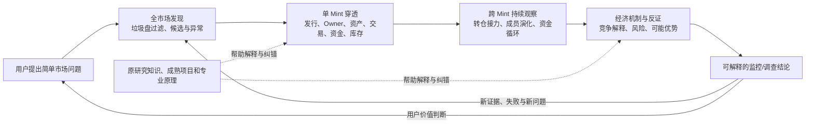

# Solana Meme × Blix｜项目目标锚点与认知深化图（V0.2）

> 2026-11-06，**当前方向的可修订基准**。用户已表达“按不同层面大致锚定目标，防止偏离，深化后可以改”的意图；下文的细分目标和专业解释包含 AI 的候选提炼，**不是每条都已由用户最终确认**。本文只帮助研究、判断和纠偏，不是新的固定阶段、专家制度、Bot 设计或默认长提示词。

## 0. 原意：目标相近但并不等同，不能互相吞并

- **最初的问题**：找到值得观察/跟随的钱包，弄清盈利、风险与可复制性。没有废弃，只是不再代表整个项目。
- **逐渐扩大的市场目的**：持续观察 Solana Meme 市场，从发行、交易、钱包、资金、持仓、群体到价格形成与经济机制，发现异常、风险、可能的机会和此前未认识的规律。
- **产品目的**：尽量以成熟 Blix 整套产品为当前基石，把真实市场发现、单 Mint 调查、跨 Mint 观察等在一个产品中贯通；先研究清楚已有业务与代码，再考虑修改、整用或补全。
- **AI 协作目的**：人只用口语表达意图；AI 自主升级问题、选择相关专业知识、深入外部证据和原代码、提出竞争方案、在授权内实施并验收；不能用漫长的知识整理代替产品成果。
- **本轮用户最新约束**：**先不运行，先彻底理解主体**。只读研究 UI、业务、数据、代码、部署/权限、真实故障与测试；不改代码、不部署、不交易、不签名、不付款。

以上是**并行且相互支持的目的**：市场情报不只是跟单；专业认知不只是写研究报告；工程设计不只是完成一次 API 测试。

## 1. 纵向目标锚点：稳定的是目的，变化的是认识与手段

| 层次 | 当前锚点（它回答什么问题） | 当前状态 / 决策权 | 何时允许改变 |
|---|---|---|---|
| **G0｜价值和人** | 以更少专业指挥负担，理解市场运作、风险和潜在经济价值；用户保有重要取舍与资金权限。 | 核心意图来自用户；价值取舍由用户决定 | 用户的价值目标真正变化时 |
| **G1｜长期产品与研究定位** | 一套可持续演化的 **Solana Meme 市场智能系统**，兼顾产品业务、经济机制认知与 AI 协作能力，而非单纯跟单信号器。 | 方向已明确；具体边界可深化 | 新发现能显著改变产品价值定位时，提出备选由用户决定 |
| **G2｜并行业务与能力目标** | ①市场发现和过滤 → ②单 Mint 调查 → ③跨 Mint 资金/群体监控 → ④经济机制、风险和潜在机会研究；可靠数据、可解释 UI、历史追溯和运行可靠性贯穿全部。 | 业务主线来自用户；细节和优先顺序允许 AI 研判 | 源码、同行经验或真实任务证明有更好的业务划分时 |
| **G3｜产品与工程路线** | **Blix 是当前研究/建设主体**；优先整体理解和成熟能力复用，再决定整用/有限适配/组合/替换；Grok Bot 是未来候选运行环境，不是既定技术强制条件。 | 当前 Blix 选择已确认；具体工程方案是可推翻假设 | 数据口径、成本、只读隔离或维护代价等证据改变选择时 |
| **G4｜当前任务与交付** | **只读全主体理解**：从 UI 和用户流程反向追踪 API、业务逻辑、数据/归因、存储、后台任务、权限与部署；记录现有能力、差距、竞争解释及整合落点。 | 用户本轮明确暂停运行；AI 承担研究和核查 | 用户授权转入实施，或证据显示当前研究已经足够支撑决定时 |

G0–G4 是**目标关系语言**，不是五个软件层、五个 Bot、五份每轮必填表格。**G4 的完成不自动证明 G2 已实现。**

### 最关键的三条横向锚点

同一个 G1 下必须同时保留三个观察方向，不能被任何一个吞并：

1. **业务与使用价值（为什么做）**：自动从市场噪声中找到可调查对象，持续看懂 Mint、钱包、群体，产生可追溯的调查结果，最终服务人的风险/机会判断。
2. **专业认知与发现（为什么这样解释）**：从链上事实推演经济行为，从行为提出资本组织/库存/价格形成的多种机制解释，主动反证，寻找此前不知道的问题和规律。
3. **工程与证据可信度（为什么可以相信）**：完整且时间正确的数据、链上资产与身份区分、失效/缺口说明、只读安全、运维与成本、成熟功能复用。没有可信事实，认知结论不能升级为确定结论。

**AI 人机协作**是一条贯穿以上三者的工作能力，而不是强制把 AI 放在 Blix 内部实现全部功能；通用方法在 [ai-d](https://github.com/sunshihao001/ai-d)，Solana 业务知识保留在本项目及原 Hermes/qb-/meme-/Why-Solana 等资产。

## 2. 业务全局：同一条贯通的价值链，不是四套互不相干的软件

- **市场发现的成功尺度**：不仅有新币列表，还要知道来源、筛选规则、覆盖与漏检、活动持续性，以及为何升级调查。
- **单 Mint 的成功尺度**：能追溯关键事实来源、时间、交易签名/动作、Token Account 与 Owner、Dev 候选、资金/库存变化、池与公共设施，清楚报告未知。
- **跨 Mint 的成功尺度**：不是列相似钱包，而是有时间连续性、成员变化、资金/资产路径、基线及多种解释；不把同时间买入自动归因为同控。
- **机制研究的成功尺度**：能解释并用新证据反驳/修正候选机制，区分结构规律、因果假设及真实决策价值；不从历史收益跳到可复制盈利。
- **统一交付的成功尺度**：优先在 Blix 现有 UI/业务路线上展现上述结果，避免重新做市场终端、重复统计、重复历史存储。

业务链允许根据进一步市场认知合并或新增环节；**“市场发现 → 单 Mint → 跨 Mint → 机制”表示典型问题演化，不是所有任务必须逐级经过的固定流水线。**

## 3. 更深一层：专业认知目标不是更多术语，而是解释能力升级

| 认识深度 | 要真正弄清的专业问题 | 必须保留的边界 |
|---|---|---|
| **观察事实** | 哪个 Mint、Slot、签名、指令/事件、账户和资产在何时发生什么？数据来自何处、覆盖多少？ | 供应商统计、链上事件、缓存结果不混写 |
| **复原经济动作** | 谁支付了什么、收到什么、持有多少；多池、CPI、SOL/WSOL、费用、Token Account/Owner 如何还原？ | 单个净余额或单一 Swap 标签不能概括多动作交易 |
| **发现行为结构** | 钱包群体是否存在资金接力、转仓、拆分、库存迁移、跨币重复与时间先后？ | 共享服务、普通跟风、样本选择、缺失历史都是竞争解释 |
| **形成经济机制** | 哪些资本约束、执行位置、流动性供需和激励结构能产生这些模式？ | 关联图不自动证明庄家、内幕或共同控制 |
| **反证与决策价值** | 机制能否预测后续可观察事实？与基线及执行成本相比是否带来新增信息？ | 必须允许 UNKNOWN、失败结论和无交易优势 |

这里的“认知深化”是一条**可选的研究深度轴**：一条高质量结论可能只停留在链上事实，也可能有足够证据形成机制解释。**不为了做深而强制推断更高层结论。**

## 4. 目前 Blix 主体理解的工程锚点

研究不是逐个文件夹罗列，而是对一条用户业务路径建立可回查的对应：

`用户操作 / 页面与路由 → API / 实时事件 → 服务端业务逻辑 → 原始提供方与链上数据 → 存储与缓存 → 计算与归因 → 展示和故障行为 → 测试证据`

全主体至少覆盖以下**问题视角**，按实际依赖交叉研究，非必须逐个线性完成：

- **UI/UX 与业务**：`web/src/` React、`public/` 经典页面，Discover/Pulse/Coin/Tracker/Narratives/Health/Account；页面存在、路由可达、真实被使用需要分别核查。
- **市场与 AI 引擎**：`engine.js`、`sources.js`、`quality.js`、`triage.js`、`research.js`、`brain.js`，对比作者原始业务目标与我们的市场智能目标。
- **Mint 与钱包事实**：`coin.js`、`holders.js`、`holderslive.js`、`wallets.js`、`wtrack.js`、`solana.js`；重视多源优先级、来源时间、钱包角色、历史/群体覆盖。
- **历史和状态可靠性**：`db.js`、`journal.js`、`journalfeed.js`、`candlestore.js`、`apicache.js`；区分原始事件、汇总 K 线、缓存快照和不可恢复的信息。
- **产品工程和风险边界**：`server/server.js`、`webapp.js`、`worker/`、`accounts.js`、Vault、部署/测试/事故；区分只读请求与后台副作用、真实交易/签名/外部收费路径。
- **外部参考的整合落点**：先查 Blix 当前是否已有相同业务，再按缺失的事实粒度和真正的功能边界比较 Million、Pulse、HoldTech、PumpTrace、OKX、Why-Solana 等；不得预设全量引入。

### 本轮已据源码发现的「需要保留的疑问」

- `/api/holders/:mint` 与 `/api/coin/:mint` 的持仓来源及完整度并不相同，不能随手选一个当唯一标准。
- `solana.js/parseSwaps` 会跳过含多个非报价代币净变化的交易；钱包监控与完整经济事实重建不是同一需求。
- `wallet_trades` 的 `(sig,wallet,mint)` 唯一键、`journal.js` 的24小时交易保留与 `wtrack.js` 的7天活动保留，限制完整资金/群体历史。
- 读取 Coin 页面可能触发后端数据补充；`GET` 不必然意味着没有提供方配额消耗。
- 生产服务包括 React/经典 UI、Radar、Web 页面服务、Cloudflare Worker 和账户/Vault 路径；原作者的历史部署证明不能替代本项目实跑验收。

上面是**SOURCE_READ + 分析判断**，不等于已经复现缺陷、跑完所有测试或实际调用过主网。

## 5. 防偏离的轻量判断：只问会改变决定的事情

研究或提议增建功能时，在需要的情况下检查：

1. **它服务哪一个 G1/G2 目标？** 如果只改善搜索词、模块数量、目录整齐或局部测试，却对业务/认知/证据没有影响，降低优先级。
2. **当前 Blix 是否已经有可用的整套流程？** 看 UI、业务代码、API、数据真实来源，而不是发现一个开源库就复制。
3. **新证据改变什么？** 是推翻现有事实口径、解释机制、产品价值，还是只带来一个有趣的新名词？
4. **额外研究还能改变决策吗？** 能，继续穿透；不能，记录边界并停止，不为凑一轮研究强行制造知识。

例：研究 `parseSwaps` 很深入，但如果最后只有“解析器需要重写”，没有说明它影响 Mint 持仓、钱包转仓、跨币监控的哪条业务链，就是**局部工程取代整体目标**。反过来，如果源码证明多动作交易被丢掉，这一事实会改变未来复用项目与数据保留的路线，就有继续研究的价值。

## 6. 什么可以锁、什么必须允许变化

| 类别 | 处理 |
|---|---|
| **相对稳定** | 用户的整体目的；市场发现、Mint、群体、机制等并行诉求；事实与推论分离；只读边界（直到另获授权）。 |
| **随研究深化** | 业务分类、对象定义、经济机制假说、哪些指标真正有预测意义、成熟成品能解决哪些问题。 |
| **可推翻的路线** | 选择 Blix 为当前主体的工程适合性；UI/接口位置、数据源、是否需要独立专业层、Grok Bot 承接方式。 |
| **可以及时切换的局部任务** | 目前的源码追踪顺序、待查测试、参考项目比较、单个新发现；不默认升级为新的长期目的。 |

当发现更深入的新目标时，AI 应说明是 `refines`（深化）、`extends`（扩展）、`alternative_to`（替代候选）、`conflicts_with`（冲突）还是 `supersedes`（确认替代）。**AI 提议可以很主动，但不能未经用户决定就替换 G0/G1。**

## 7. 当前研究交付条件与明确暂停项

**当前允许**：GitHub 只读查源码与历史、外部原始论文/官方文档研究、跨层业务追踪、竞争解释、将核实结论写入本分支项目文档、回读核对。无需每研究一个子问题就重新征求确认。

**当前暂停**：运行 Blix、装依赖、接入模型/RPC/外部配额、调用真实 Mint 接口、云电脑部署、改市场/账户代码、签名、交易、付款。后续执行需用户新指令。

本阶段有意义的完成物不是文件数，而是：主要业务在 UI→API→核心代码→数据与存储→权限/运维→证据的映射；已有、重复、缺失及 UNKNOWN 清楚；关键错误假设与整用/有限修改/组合路线可比较。**只有研究结论足以指导具体集成判断时，才称“主体已经理解到可决策程度”；不声称每个文件逐行证明。**

## 8（新增认知）｜2026-11-07 ai-d 最新研究怎样修正问题表征，而非替换目标

**固定的目标关系不变**：现有G0–G4只是Meme项目内部目标语言。用户仍希望Blix单主体承担市场发现、单Mint调查、跨Mint观察、经济机制理解与可验证机会研究，AI负责口语意图升级、跨源调查、授权内交付。ai-d [认知增强研究](https://github.com/sunshihao001/ai-d/blob/84b9d3fe4e22d6c1621623cf26deb4b3ab5092e7/research/2026-11-07-human-ai-cognitive-augmentation-foundations.md) 与 [人机委托研究](https://github.com/sunshihao001/ai-d/blob/84b9d3fe4e22d6c1621623cf26deb4b3ab5092e7/research/2026-11-07-human-ai-delegation-performance-learning.md) 属于横跨多个领域的**上游研究方法**，不能把“人的发展/学习”新愿景自动替代本项目领域目标。其[更宽广的人类能力愿景](https://github.com/sunshihao001/ai-d/blob/aba723074d2c1a83fb129bd14473fa571f29ad34/README.md)目前还在Draft分支，属于ai-d的独立上位研究，不是Blix已有业务或已确认新产品。

**新的问题表征重心**：[ai-d 2026-11-07未知发现研究](https://github.com/sunshihao001/ai-d/blob/84b9d3fe4e22d6c1621623cf26deb4b3ab5092e7/research/2026-11-07-problem-driven-unknown-discovery.md) 要求从“用户已给出的术语→查相近知识”进入“识别旧解释隐藏变量、观察机制、竞争生成机制、跨领域中间关系、反例”。并非所有重要未知都是新的操盘手法；**未知至少有四种不同对象**：已知资料缺口、尚未意识到的问题缺口、此前未建立的跨行业机制联系、尚无可重复证据证实的真正开放世界未知。AI只能主张自己找到了可检查的新问题/关系，不得自称发现了无人知晓的市场定律。

**对业务价值链的具体修正**：同一“早期钱包活动/拉升前资金异动”须区分(1)实际市场经济过程，(2)数据源监听/筛选/保存/补录/优先级的观察过程，(3)AI从观察生成解释的推理过程。Hermes提供反向机制问题，qb定位证据对象和契约，meme提供失败样本/竞争解释，Pulse/Blix等源码揭露观察管道边界；**是否接入代码**独立于**是否值得继续学习该知识**。上述三者可作为研究维度，但不是必须在每个普通问题上执行的三个步骤或三个Bot。

**人机分工的新限制**：ai-d 依据2024年106实验的系统综述与2026年487人随机试验，区分“AI在场任务表现”“没有AI时人的独立技能”“人机协同能否优于单方”。对当前Meme项目，用户要的是低专业指挥负担和可核查成果，**不应被迫学习编程或每步审批**；AI在已有授权和只读边界内直接研究/写入文档/回读核验，重要方向、真实资金、签名、付款等由人保有决定权。不能据论文推断Blix已证明有协同优势，也不把用户学会市场研究当成产品交付的必要条件。

**研究成功的新判据**：不是读过项目/新增领域/得出更复杂叙述，而是新来源或学科能够**真正改变某个调查问题的表征、暴露此前遗漏且可核查的变量、区别两种机制、纠正现有事实或改善已有Blix成果**。其余价值不明材料保留原文与未解问题，不因目前无产品位置丢弃；避免无限扩展、无证据类比和过度上下文注入。

**当前验收状态**：仅上游新研究原文核查、既有Solana源码/确定性反例对照与Blix知识关系修订；并无新的独立模型A/B、真实钱包回放、市场因果机制证实或Grok Bot运行时调用。本论证不改变现有只读限制。

## 8. 知识与历史入口

- [Blix 主体导航](README.md) · [能力/参考地图](capability-map.md) · [当前交付状态](delivery.md) · [知识与证据用法](knowledge-use.md)
- [ai-d：目标导航研究](https://github.com/sunshihao001/ai-d/blob/proposal/goal-planning-knowledge-delivery-20261106/planning/goal-navigation-v0.1.md)：多目标、分层与主动纠偏；方法草案，不是自动目标算法。
- 原 Grok [PR #14](https://github.com/sunshihao001/grok/pull/14) / [#16](https://github.com/sunshihao001/grok/pull/16) / [#17](https://github.com/sunshihao001/grok/pull/17)，Hermes、qb-、meme- 和 Why-Solana 的原始研究仍原位保存，**知识资产继续有用，历史固定流程不再默认控制新研究**。

**一句话锚点：以 Blix 为当前可修订的产品主体，从市场事实和业务需求出发，理解整个系统，逐步复原经济行为、解释并反证机制，最终形成持续可信的只读市场智能能力；AI 主动承担研究和整合判断，用户掌握重要方向与风险决定。**
