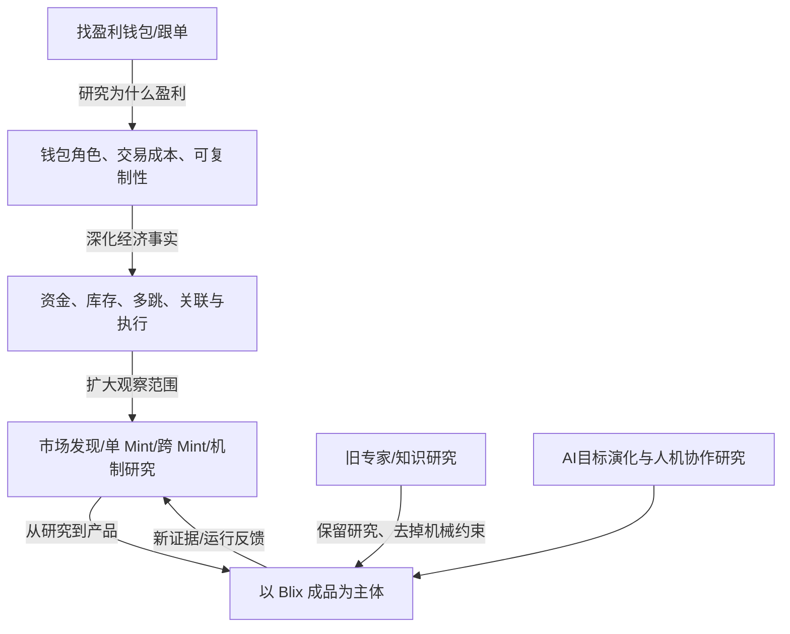

# 目标层级与网络｜从跟单钱包到专业市场智能

方法来源：[ai-d 的五层目标与多重锚点](https://github.com/sunshihao001/ai-d/blob/proposal/goal-planning-knowledge-delivery-20261106/planning/goal-navigation-v0.1.md)。这只是让目标**被理解和核查**的视图，不是五个软件模块或永久固定流程。

| 层级 | 目前的目标 | 谁负责改变 |
|---|---|---|
| **G0 价值** | 用户降低专业技术负担，理解市场风险与潜在经济价值 | 用户 |
| **G1 长期** | 建成持续演化的 Solana Meme 智能产品；AI 主动承担专业研究、实施和发现更有价值的下一步 | 重大改变由用户确认 |
| **G2 能力** | 市场发现；单 Mint Creator/资金/钱包/筹码调查；跨 Mint 群体监控；经济机制/机会研究；统一 UI 和可靠证据 | AI 细化，用户决定重大取舍 |
| **G3 路线** | 用户确认 `blix` 分支作为建设主体；外部成熟项目补能力、方法、代码设计和失败经验；Grok Bot 为未来可选执行环境 | 一般可逆技术选择由 AI，重大改变向用户说明 |
| **G4 任务** | 建立项目入口，审查只读隔离和自动费用，使用真实 Mint 检验首个调查闭环，再补持续监控 | AI 执行并报告实际证据 |

## 目标演变不是简单替换

关系采用：`refines`（深化）、`extends`（扩展）、`supports`（支持）、`alternative_to`（备选）、`supersedes`（用户确认替换）。新 AI 设想**默认为提案，不是用户的最新决定**。

## 两条并行的成长主线
1. **市场能力**：从钱包榜单 → 真实经济事实 → 群体行为与资金网络 → 可证伪机制 → 可能的预测价值；不能从同步行为跳到内幕身份，从历史表现跳到可复制盈利。
2. **AI 协作能力**：理解模糊意图 → 选择知识/发现未知 → 成熟方案比较 → 授权内行动和验收 → 反证和结果后再推演；目标本身可以变化，但 AI 不得擅自重写人的价值选择。

ai-d 提出的七个并行目标锚点（理解、知识组织、开放探索、独立判断、实际交付、证据纠错、长期继承）是**关注维度**，不是七阶段/七个 Bot。每轮具体任务不必输出全表，但不得让局部检索或分类代替上层产品交付。

## 当前确认与未确认
用户确认：Blix 作为当前主体、原专业知识保留、AI 主动推进、初期只读。AI/源码推论：Blix 可能可以较低成本承载更多专业调查。尚未验收：Blix 在目标云电脑中安全长期运行、完整资金群体归因、6/12小时历史覆盖、真实可交易优势。
