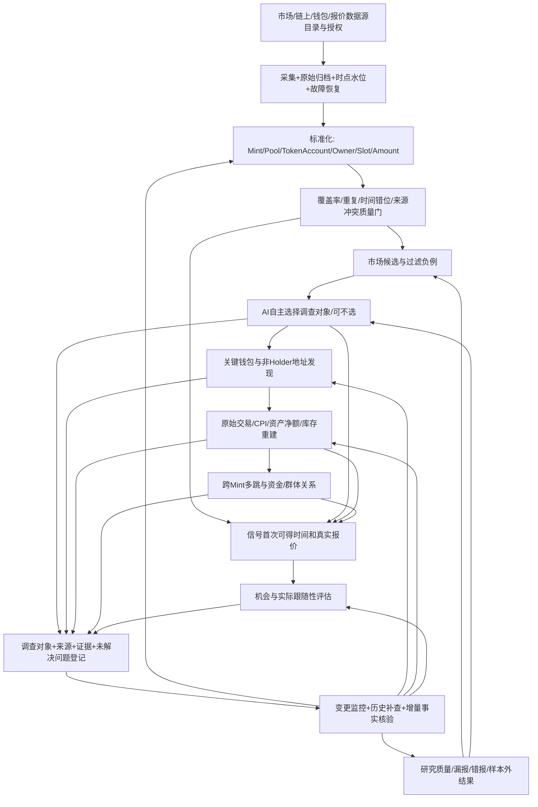

# Blix 独立 AI 工作台｜六大业务结果的全前置能力与依赖审查（2026-11-13）

> **纠偏：六个业务结果 ≠ 六个完整开发阶段。** 本文不是新增一套平行专家制度或从零搭架构，而是对当前已有产品与 PR #23 的源码做依赖层次复原，避免“做了最后一个按钮，忽略之前的采集与取证”的假完成。保留原版 Blix；只读优先。各小阶段的意义是**能力依赖与验收项目**，不是所有任务必须严格经过固定六步。对所有新数据事实按：`源头原文 / 归档已验证 / 解析输出 / 专业解释 / 未知`分别表示。

## 0. 最关键的审查结论

此前把“AI从当前Pulse最多12个候选选Mint”标作“自主发现市场机会”，属于**终点动作被误当整阶段完成**。它只完成`现有候选中的有限调查对象选择`。其前置的市场覆盖、来源时效、缺口、价格与成交对齐、完整候选评价并未由独立AI服务验证。当前`pulse-discovery.mjs`中`browserRecordedAtMs`只是本机发送时间，不能当数据提供方或链上的首可见时间。

更深层的问题：后续五个业务目标也各有未核的前置能力。一个后续模型输出若建立在不完备的采集/索引/解析上，应先标`PARTIAL_OR_UNKNOWN`，不能靠复杂知识或跨币关系图补成完整事实。

**全部工程目标分为三个不同维度，彼此依赖：**
1. **数据/事实链**：采集→归档/时点/水位→标准化→解析→身份与资产归属→经济事实→可反查证据。
2. **研究/判断链**：发现对象→提出问题→选择工具与专业知识→竞争解释→反证/进一步取证→机会/风险与可参与性。
3. **运行/反馈链**：授权/配额→质量监控→历史补查→状态保存→新事实触发→修改结论→对照评价。

六个业务结果的“前面小阶段”并非全都在本阶段内部：需要共用这三条基础链，不能每项再创建独立采集器、钱包解析器或数据库。

## 1. 跨六大业务目标共享的底座（实际起点）

| 基础能力与细分项 | 来源/内容 | Blix 目前有何复用 | 尚缺或未验、不能跳过的门槛 |
|---|---|---|---|
| D01 对象及权限 | Mint、Token Account、Owner、钱包、池/Vault、市场事件、交易签名、钱包群体；只读边界、服务权属 | `server/coin.js`、`solana.js`、`bubblemap.js`、`intelligence/index.mjs` | 不可把池或托管地址误判经济人；AI工具授权不能靠`GET`名称，原`/api/token/:mint`有潜在收录副作用 |
| D02 来源目录及适用性 | 数据覆盖的链/DEX/协议、字段含义、粒度、API权属、延迟、配额/费用、许可及供应商失效 | `sources.js` DexScreener/GeckoTerminal/RugCheck/Jupiter；`livetrades.js` launch与pool feed；`heliuskeys.js` RPC配额 | 源目录、覆盖目标、估算漏采和实际源级第一可见时间尚未统一成AI可核的契约；免费接口也可能限速与变化 |
| D03 原始事件采集与保存 | WS/RPC/API取数、原始签名/Slot、完整交易、CPI/inner、提供方原始快照、hash、源信息、错误响应 | `engine.js`、`livetrades.js`、`wallets.js`读钱包；`economic-events.mjs`记录部分完整RPC JSON | 市场候选与原始交易不是同一完备数据集；交易存档受已追钱包约束，不能当全Mint历史 |
| D04 流水线可靠性 | 去重、断连/重连、历史游标/补查、重组/finality、重复消费/幂等、缓存TTL、断流水位、处理失败队列 | `coverage.js`、`wallet-signature-coverage.mjs`、`econ_wallet_processing`、feed/history相关恢复与缓存 | 多数据源、市场和钱包跨链路统一覆盖报告尚未证明；不能以“本次无事件”推断市场无事件 |
| D05 事实统一口径 | Mint+池、TokenAccount与Owner、资产精度/Token-2022、SOL/WSOL、费用、Swap/LP/Token Transfer，事件时间与首次可见时间 | `holders.js` partial账本；`solana.js`已有部分Swap解析；`economic-events.mjs`保留指令位置与原始值 | 多动作交易完整经济净额/成本基础、跨池同Slot对齐仍有缺口；`wtrack.parseTransfer`对复杂交易会省略摘要 |
| D06 数据血缘/查询 | 原文→索引→计算→钱包/资金图→AI陈述；记录获取时点、源、版本、置信边界、失效条件 | `economic-claim-trace.mjs`、`mint-economic-evidence.mjs`、`local-knowledge-loader.mjs` | 只在局部已捕获证据链成立；未证明历史交易/行情全覆盖与实时可用 |
| D07 AI/知识/成本/合规 | 模型权限、工具清单、知识选择、模型版本、提示词、token/预算、安全隔离、可重试策略、隐私 | `chat-completion-model.mjs`、`ai-workflow.mjs`、`research-http.mjs` 本机单Mint/12候选受控能力 | 真实供应商API未验；模型输出未经链上独立核实；模型预算限制按进程、非财务硬限 |
| D08 独立运行验收 | 同输入对照原版/经济规则/模型知识；历史回放、反例样本、真实RPC+代码/集成/运行证据分层 | 已有节点单测及Actions，`brain.js`历史分数，`followability-replay.mjs`纸面校验 | 没有统一真实市场前瞻实验，未做跨阶段线上验收或交易机会统计；CI绿色不代表业务已达成 |

**设计原则**：D01–D08不是八个新模块。它们是既有能力和缺口的一张共享依赖表；能复用就不再建一份。

## 2. 业务结果①：自主发现值得调查、值得参与的代币

目标是**在预先确定的覆盖范围内，尽可能及时地发现值得调查的候选，并保留误报、漏报与未选中的样本**，不是给12个现成币排个名。

| 内部必需环节 | 前置/输入 | 处理、产物与验收 | 当前状态 |
|---|---|---|---|
| 1.1 定义市场宇宙 | 链/发射平台/DEX、New/Running/FinalStretch/Migrated、历史时间窗 | 说明覆盖了哪些来源及未覆盖哪些币，不把Blix看板等同Solana全市场 | **部分**：原`engine`/`pulse`有多源分段；AI未继承统一覆盖契约 |
| 1.2 数据源遴选与接入 | `sources.js`、`livetrades.js`、Solana RPC、公开池/风险数据 | 明确每源字段、频率、权限、费用、失效备选；至少一种持续发行/交易候选流 | **原版已有，未独立验证AI链路** |
| 1.3 实时采集与补漏 | 发射、迁移、市场成交/池、钱包买卖、热点流及历史 | 保存源头消息的事件ID、交易/slot、链事件时间、接收时间、来源，断流后补缺 | **局部**：`coverage.js`能找错过Pulse栏目的活跃币；统一水位与回放未验 |
| 1.4 原始数据归档/标准化 | 代币/池/来源不同的对象记录 | 同Mint多池对齐、来源冲突留痕、消重、检测错误资产/极薄池；保存所有被筛/未筛候选 | **分散存在**：`db.js`/`pulse`/`feed`等；统一可复查市场全样本未验 |
| 1.5 数据健康 | 采集速率、slot延迟、断流、API 429、缓存、源失败 | 出具每源覆盖、候选缺失、水位差、第一可见时间及UNKNOWN；源断时不出虚假“市场平静” | **部分**：`feedlag.js`/`heliuskeys.js`/sources throttle；AI未获取整份健康/覆盖事实 |
| 1.6 候选事件提取 | 合格观察窗、连续成交、流动性/年龄/鲸鱼/发行者、价格变化 | 形成带原因和原始观察窗口的事件候选，保留负样本及筛掉原因 | **原版已有多个入口**：`triage`/`early`/`brain`/`coverage`；独立AI只读当前看板截面 |
| 1.7 专业筛选与目标选择 | 原版候选、已有钱包/资金先兆、知识解释、负例、观察成本 | 规则先做确定性筛选，模型提出并对比真正不同的调查理由，可主动不选 | **已做局部**：`pulse-discovery.mjs`最多12个，先选知识后选Mint；非完整市场覆盖 |
| 1.8 候选研究优先级/升降级 | 市场时效、历史中断、需补资料、工具预算 | 选择最能减少关键未知的对象和下个问题，而不总选涨得最多的 | **待真验**：目前模型输出reason，没有可观测调查增益对照 |
| 1.9 早期表现与漏报反馈 | 同一输入宇宙的已选/未选/被拒样本、市场首次可见时刻 | 校验召回率、假阳性、覆盖漏报、API成本、是否真正比原Blix更早发现机会 | **待验**：`brain.js`/`early.js`已有部分反馈，但本AI队列没有相同的实证对照 |

**第一阶段完成条件**：不只是`SELECTED_MINT`。至少同时有`MARKET_UNIVERSE_DECLARED`、`SOURCE_FRESHNESS_AND_GAPS`、`CANDIDATE_LINEAGE`、`REJECTED/MISSED_CANDIDATES`、`SELECTION_REASON`和前瞻对照结果。无证据的字段保持UNKNOWN；可允许仅完成“有限候选调查”，但不得写“自主市场机会发现已完成”。

## 3. 业务结果②：发现并识别关键钱包/资金参与者

| 小阶段 | 输入与步骤 | 需要的产物/反例 | 现状 |
|---|---|---|---|
| 2.1 选择调查目标与时间点 | 从Mint、发行者、首批买卖、池关系或上游钱包进入；冻结关键Slot/时间窗 | 明确为什么从这些地址开始，而非只挑当前Holder | 部分：Coin/BubbleMap/Wallet已有入口 |
| 2.2 发现全部“候选地址来源” | Holder topN、Creator与历史、首买、首筹码、转出方/接收方、资金出资人、非Holder中转、池/路由 | 来源与筛选范围；**不能把Holder榜单当全量参与者** | 部分：`bubblemap.js`含RugCheck与首资助，`inspect-economic-mint`只查已捕获最多10发送者 |
| 2.3 账户身份与角色分离 | Token Account→Owner/Authority→Fee Payer→Program/Pool/Vault/DEX/CEX | 每条地址角色有可核来源，不能把TokenAccount或池当私人钱包 | 部分：`economic-events.mjs`与BubbleMap；历史真实Mint已发现Pool Holder混淆案例 |
| 2.4 钱包历史采集/补全 | 钱包签名分页、交易原文、行为事件、重试、水位 | 每钱包“已到哪一签名/哪一段缺口”；缺失不等于没有历史 | 部分：`wallet-signature-coverage.mjs`与wallet reader，未证明任意新地址完整 |
| 2.5 钱包行为分类 | 买入/卖出/加减LP/转仓/收款/刷量/KOL/发行相关/服务地址 | 可多标签、时间演化、竞争解释；拒绝只凭共Slot/共资金认定同控 | 旧Hermes/qb-知识候选 + 部分源码；真实多角色分类效果未验 |
| 2.6 钱包筛选与关系验证 | 经济规模、反复时序、同源资金、成本/库存、操作共现和公共服务排除 | 候选与可确认角色分层；记录为什么追、为什么排除 | 局部网络候选，但经济身份`UNKNOWN` |
| 2.7 转入下一环与持续观察 | 选出值得重建库存/资金的地址、保留相关签名 | 输出`KEY_WALLET_CANDIDATES`及覆盖程度，不冒充确认实体 | 现`investigation-continuation`仅对捕获地址排序，尚非完整发现 |

**完成条件**：关键钱包不仅是标签/图中的点，还要能够说明“从何发现、身份是什么、依据哪些交易、历史覆盖到哪里、为什么值得继续追或排除”。

## 4. 业务结果③：还原真实资金、筹码和库存变化

| 小阶段 | 输入与步骤 | 产物/验收条件 | 现状 |
|---|---|---|---|
| 3.1 获取最小可复查事实 | 原始签名、Slot、tx/meta、pre/post、inner CPI、账户加载表与源校验 | 能按签名重查交易，失败/不完整标出 | PR #23局部`econ_transactions`原文与SHA |
| 3.2 解析程序动作 | v0/ALT、System、SPL Token/2022、Pump/Pool/Router、Swap、LP、Transfer | 单签名多指令不丢、不重复、不把费用或WSOL误计资金转移 | `economic-events.mjs`Token/SOL转账索引；完整经济动作仍缺 |
| 3.3 主体与经济对价 | TokenAccount Owner、FeePayer、池/设施、资产净额、SOL/WSOL边界 | 指出谁发生余额变化、谁承担费用及真实对价 | 部分；Owner不等于控制权，手续费边界未全校验 |
| 3.4 构建资产库存账 | 初始/转入/买入/转出/卖出/LP变化、库存连续性、Token2022费 | 哪些数量确定、哪些批次/成本/归属未知，不凭后卖出证明卖的是上次转入 | 当前只有部分转移/后卖出摘要；成本与批次未知 |
| 3.5 构建资金网络和时间线 | 来源/去向、资产类型、金额、边的签名与窗口 | Token转移边、真实SOL出资边、手续费/共享服务不混淆；支持原证据反查 | `economic-network.mjs`与`economic-claim-trace.mjs`局部可用 |
| 3.6 机制解释与反证 | 交易与LP、筹码组织、奖励空投、营销、做市、共控候选 | 对每个“协同出货/刷量/分仓”给竞争解释与打破该解释的证据 | 已有理论，真实链闭环未验 |
| 3.7 归因与账目验收 | 签名级去重、Token数量守恒、交易前后资产净变、漏动作率 | 输入/输出样本均可重演；不得用总收益/库存预测替代缺失数据 | 部分离线测试；本Mint实跑未完整 |

**完成条件**：从单条签名到资产流量/库存的可逆取证链，能解释**哪些资金/Token已经确认移动、哪些只是候选路径**，而不是画一张复杂关系图。

## 5. 业务结果④：发现跨 Mint 资金和钱包群体联系

| 小阶段 | 输入与步骤 | 输出/风险防线 | 现状 |
|---|---|---|---|
| 4.1 形成跨币调查触发器 | 钱包卖出、Token转移后接收方卖出、SOL流转、某钱包新币买入、多Mint复现行为 | 明确触发来源与第一可见时间，非“看到钱包两个币就算资金接力” | 部分本地wallet_trades与候选查询 |
| 4.2 寻找非Holder中转和新地址 | 追Token接收者及SOL出资后继，按路径与时间剪枝，剔除系统/池/DEX/CEX设施 | 能找到未进入目标Mint Holder榜单的新钱包；保留共享服务候选 | `bubblemap.js`部分中间关系；跨Mint完整多跳未验 |
| 4.3 多Mint原始证据扩张 | 每个新增地址的相关签名、其它Mint买卖和资金转账、slot排序/最终确认 | 事件因果时间链、数据采集窗口、历史缺口与重复动作 | `crossMintCandidates`仅局部历史SQL时间联结 |
| 4.4 资金来源和经济实体判断 | SOL/WSOL/费用净额、账户混同、是否同一池/托管、Jito与服务设施 | `same wallet`、`funding edge`、`same controller?`分别标，不凭bundle/多跳断言同控 | 代码明确仅`TEMPORAL_FUNDING_PATH_CANDIDATE` |
| 4.5 群体动态与跨币重复 | 行为相似度、协同先后、钱包加入/退出、多个Mint复现的结构模式 | 时间窗外对照与错例，防止把活跃公共服务当“庄家网络” | 部分理论/候选，尚非成熟连续监控 |
| 4.6 路径验证与跨币报告 | 签名/指令/净资产变化/时间窗/缺口/竞争解释 | 可点击的跨Mint交易收据、未证实资金来源和失效条件 | 局部离线关系，**无已核真实资金闭环** |

**完成条件**：至少真实重放一条跨Mint多交易链，钱包/设施已分类、时间顺序可核、重复和空窗可解释。即便完整主链已获，仍可能不能证明实际同一受益人控制，保持UNKNOWN。

## 6. 业务结果⑤：判断是否具有现实交易/跟单参与价值

| 小阶段 | 输入与步骤 | 产物/反证 | 现状 |
|---|---|---|---|
| 5.1 明确机会类型 | 新发行早期、资金异动、吸筹/释放、钱包跟随、跨池流动性、价格冲击等 | 不同假说不同的入/出场验证，不给全部机会同一个AI分数 | `early`/`brain`有原版不同入口 |
| 5.2 信号首次可得时点 | 链事件时间、来源被AI看到/处理时间、用户/模拟者可操作时间 | 排除“事后看到前面K线就假设能买到”的前视偏差 | `followability-replay.mjs`有严格校验；真实信号全源时间尚缺 |
| 5.3 当时的市场可成交数据 | 同时点Pool/Vault/路由、可执行Token入出报价、深度、费用、优先费、拥塞、滑点、MEV/夹子 | 指定可交易数量和路线；不同池报价不同；历史快照不等于可执行报价 | 原版Jupiter与行情有部分入口，历史实价收据未接到独立AI |
| 5.4 风险与退出 | 可否卖、冻结/税费/流动性撤出、持有库存、部分成交、退出路径 | 无合理退出就不能报正收益；区分事件风险、市场风险、执行风险 | 原版风险检查/纸面模拟，未统一历史真实报价 |
| 5.5 策略规则和受限模拟 | 资金规模、信号延迟、手续费、滑点、条件筛选、止损/退出规则 | 只读纸面模拟+敏感性分析；不得触发原交易代码 | `followability-replay.mjs`做用户提供纸面收据检查 |
| 5.6 样本外回测与机会质量 | 同来源全体候选、跳过者、错过者、失败币、时间分割、可执行性及风险 | 机会基准与AI增益、收益不确定性、失败条件及成本 | `brain.js`/`early.js`部分历史反馈，未针对新AI实验 |
| 5.7 决策呈现与停止 | 是否需要更多数据、只观察/需要核价/不可评估 | 输出“值得调查/值得观察/具备可评估参与条件/无法判断”，不能伪造买入信号 | 当前固定`UNASSESSED...`，**不能宣称已判断机会** |

**完成条件**：决策建立在**当时实际可知且成本可计的报价和退出约束**上；盈利概率需样本外测试支持。没有这种数据就只可说“调查价值”，不能说“可跟单”。

## 7. 业务结果⑥：持续观察、自动修正与长期学习

| 小阶段 | 输入与步骤 | 产物/验收 | 现状 |
|---|---|---|---|
| 6.1 研究对象持久登记 | Mint、钱包/群体、已知签名与数据窗口、问题/假设/反证/知识版本 | 可重新打开同一调查；不同样本不误拼 | 原版多种SQLite持久记录；独立工作台尚无调查case收据 |
| 6.2 变化监控事件目录 | 钱包新买卖/转仓、新成员/资金接力、Pool/Holder/流动性/价格突变、数据恢复 | 每类明确定义监听来源、触发条件、去重与权限，不是无差别全时LLM | 原Blix有Wallet/Market事件；独立AI未授权后台监控 |
| 6.3 增量抓取/恢复 | WebSocket/RPC增量游标/轮询、漏页/重连/重组、源故障 | 事件不丢不重复、恢复新事实的首可见时间 | 部分原版基元；AI独立工作台没有全链路 |
| 6.4 增量经济重算 | 新事件 vs 历史存档、资产库存/钱包关系/跨Mint新边、旧证据修正 | 区分真正新事件、迟到回填、同签名解析修正、采样截断 | `economic-snapshot-review.mjs`有离线比较，未形成持续运行 |
| 6.5 AI按需重新解释 | 触发的新事实、变更的专业知识、竞争解释/失败反例 | 结论修订有版本/反证/原因；不能让模型每分钟从头写报告 | `ai-workflow.mjs`单次任务，尚未自动增量调用 |
| 6.6 提醒/人机交互边界 | 仅可核实的新变化、重要级别、来源、通知开关 | 未授权不自动推送/外发；可撤销与限频、成本限额 | AI独立工作台未实现 |
| 6.7 长期结果评价与回授 | 已选/未选、正确/错误预警、查证耗时、缺口改善、误报/漏报/净收益 | 发现真正改进的规则/知识与其反证；不因持续监控而自认正确 | 仅原版部分研究反馈，跨阶段闭环未验 |

**完成条件**：至少跨两次真实数据变化保存并恢复同一调查，展示证据增量和判断修订；完整处理源缺失、迟到回填、数据恢复、撤销。单次报告末尾写“继续观察”**不能**算“持续监控已实现”。

## 8. 依赖网络：不是六个独立管道，而是可分叉的全链路

**AI贯穿多个节点，但计算、取证、时间对齐和权限必须由确定性代码与数据源事实承担。** 某个Mint可以从钱包事件直接进入C，而不经A/B；没有可执行报价时可以停在D/E作为情报调查成果，避免强行给买卖意见。

## 9. Blix源码能力盘点：已有、局部、没做，不以文件数当进度

已观察到的代码事实（不是线上验收）：
- **原市场层**：`sources.js`（公开数据）、`engine.js`（发射发现/收录/补查）、`livetrades.js`（链日志/实时交易）、`coverage.js`（跨Pulse分栏漏币修正）、`holders.js`（partial和链上seed），`triage.js`/`early.js`/`research.js`/`brain.js`（初筛、研究、纸面结果）；这些是应该复用的成熟原版基础，不能复制第二套终端。
- **钱包/链事实层**：`wallets.js`读钱包、`wallet-signature-coverage.mjs`签名分页断点、`economic-events.mjs`单笔RPC原文+指令索引、`bubblemap.js`局部非Holder中间关系与Pool剔除；仍不是“任意Mint/钱包全历史经济动作已经解析”。
- **PR#23 专业层**：`mint-economic-evidence.mjs`、`economic-network.mjs`、`economic-claim-trace.mjs`、`economic-snapshot-review.mjs`、`followability-replay.mjs`等有有限只读、可复查与拒绝错误结论的测试；原始库存、全数据源与真实报价仍不完整。
- **AI工作台层**：`pulse-discovery.mjs`仅限网页候选12条，`research-http.mjs`本机受限工具、`chat-completion-model.mjs`模型API接口、`local-knowledge-loader.mjs`11个固定已有知识源、`investigation-continuation.mjs`只投影局部六环证据状态；无真实付费模型端到端验收、无全市场独立覆盖、无持久自动监控。

**证据等级**：上述能力陈述是`SOURCE_CODE_OBSERVED`，现有测试才可标`MOCK_OR_OFFLINE_TESTED`；真实用户运行、外部供应商完整语义、稳定历史回放另需验收，不能因为已有文件名就写“运行完成”。

## 10. 真正应采用的推进顺序（以依赖解锁和业务价值优先，不写死年月）

| 优先层 | 先解决的跨阶段缺口 | 为什么比新增功能更重要 | 验收输出 |
|---|---|---|---|
| **P0 采集事实链** | 审计“哪类市场/钱包/池事实从哪里来→如何落盘→如何补查→在哪里被抽样/截断”，优先复用原Blix所有源，建立**源头到AI查询**的可核数据契约 | 没有可信输入，后面AI发现/钱包图/机会评分都会以局部为全量 | 至少一个真Mint的源状态、时间水位、原始签名/快照及缺口报告；无数据时报告`UNAVAILABLE` |
| **P1 钱包/经济完整性** | 沿一条实际业务链重建“买入→Token转仓→B后续卖出”，先核TokenAccount与Owner、Swap/LP/CPI边界、金额守恒，再扩非Holder/跨Mint候选 | 解决2–4阶段共同缺口，且最能产出目前Blix缺少的高价值专业事实 | 可复查的真实签名/边/缺口；当B卖出同批Token/同一SOL来源不可确认时保留UNKNOWN |
| **P2 多源市场机会可参与性** | 把原`early/brain`已存的选/未选对象、原始可见时间、当时报价和费用接到同一对照集 | 决定系统究竟提高市场机会发现还是只生成复杂解释 | 原版 vs 规则增强 vs AI知识，前瞻/时间隔离对照，保留漏报/成本/负例 |
| **P3 可继续调查与真实监控** | 当P0/P1已有稳定增量事件，才实现调查收据持久化、事件触发重算、从新证据修订结论和失效告警 | 没有准确水位/事件ID的监控只能不断重复旧分析 | 至少两次真实观察更新/补查可重开，能区分增量、迟到数据与重复，支持停止/限额 |
| **并行安全门** | 明确本地只读服务与原Blix业务服务副作用、模型调用/供应商账单、访问控制与合规 | 不为“自动化”误开交易或让敏感历史数据不受控外发 | 不交易、不签名、不乱RPC、不发送未授权消息；线上部署前独立验收 |

**并非必须等P0做到“所有主网数据全量”才开始P1**。专业做法是声明一个清晰可测的范围，例如“一枚真实Mint＋一个特定时间窗＋指定的Swap/LP与钱包交易”，把源头、历史缺口、签名和成本核清，再扩张覆盖。避免以无边界的“采集所有资料”造成新的停滞。

## 11. 交付判定、责任边界、风险锚点

**每条小阶段结果要回答的6个问题**：
1. 输入事实从哪来（哪家源、哪个接口/文件/原始交易）？
2. 该输入数据的覆盖范围、时间/延迟、历史缺口与费用是什么？
3. 经过什么解析/过滤/经济计算，是否保留原数据可重演？
4. 哪个结论是链上可观察、哪一部分是机制推论、什么仍是UNKNOWN？
5. 输出被下一阶段的哪个具体能力消费？用户能否从UI回到源头？
6. 如何证明本次改动**比原Blix多发现可靠事实或节约成本**，以及什么时候停止扩建？

**当前最严重的三项风险**：
- `FOUND_CANDIDATE ≠ VERIFIED_OPPORTUNITY`：现12候选是页面可见数据；浏览器提交时间≠源头首次可见，不能跳过完整数据源/覆盖门。
- `NETWORK_EDGE ≠ ECONOMIC_CONTROL`：TokenAccount/Owner/Pool、Swap/LP与多次转仓有不同含义；时间先后不证明库存批次或资金闭环。
- `PAPER_RESULT ≠ FOLLOWABLE_NET_PNL`：单池市场报价/流动性与交易费用不能从事后价格涨跌替代；历史执行必须排除前视和退出不可达。

如果新增阶段只增加流程图、报告、知识引用和更多接口名，却没有更好的实际采集、重放、归因、可参与性或持续修订能力，应判定研究方式错了，**停止扩架构，回到最早未满足的输入条件**。

## 12. 可复查源码与历史证据

- 当前分支：[PR #23](https://github.com/sunshihao001/grok/pull/23)，目标`blix`分支，未合并/部署且存在冲突；历史`docs/project/build-register.md`的R-20至R-23记载局部实现与局限。
- 真实Mint归档再审：[single-mint-audit.md](single-mint-audit.md) —— 三次真实供应商时点提供主池库存/价格变化、Pool Holder误判反例；**不是**跨钱包/跨Mint原始RPC完整链。
- [blix-ai-investigation-product-comparison-20261113.md](blix-ai-investigation-product-comparison-20261113.md)：Million、PumpTrace、Bubblemaps、Pulse、dexterm等业务对照；其资金/用户身份/利润说法仍需要独立复查。
- 原版市场源码：`server/sources.js`、`engine.js`、`livetrades.js`、`pulse.js`、`coverage.js`、`holders.js`、`triage.js`、`early.js`、`research.js`、`brain.js`。
- 原版与集成的事实代码：`server/wallets.js`、`wallet-signature-coverage.mjs`、`solana.js`、`bubblemap.js`、`economic-events.mjs`、`intelligence/{pulse-discovery.mjs,investigation-continuation.mjs,mint-economic-evidence.mjs,economic-network.mjs,economic-claim-trace.mjs,followability-replay.mjs,research-http.mjs}`。
